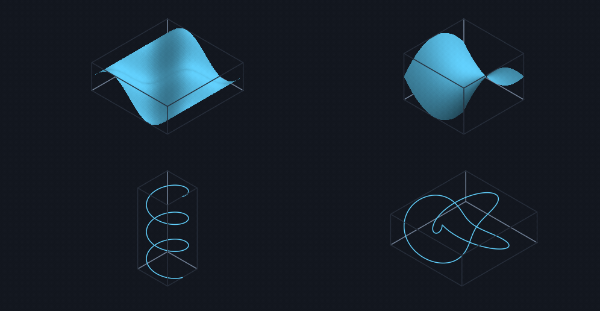

# rsille

English · [中文](README_cn.md)

[](https://crates.io/crates/rsille)
[](https://docs.rs/rsille)
[](https://rsille.vercel.app)
[](LICENCE)
[](#try-it-in-10-seconds)


**Make your terminal come alive.**

Float an animated pet or clickable widgets **directly over your live shell** (even over `vim`). Plot rotating 3D math surfaces inline with **Kitty & Sixel**. Build animated TUI workspaces with floating windows, visual effects, and Unicode Canvas graphics — all powered by one Rust framework across **Linux, macOS, and Windows**.

## One terminal. Many possibilities.

| Pixel graphics · Kitty & Sixel | Desktop-style layouts · TUI |
| --- | --- |
| [](packages/rsille-playground/function-plotter/README.md) | [](examples/lumen/README.md) |
| **Graphics beyond character shapes.** RGB pixel canvases output through Kitty or Sixel with layout, clipping, scrolling, and opaque coverage. Embed fine curves, 3D plots, images, and math formulas directly in your UI. | **More than fixed panels.** Compose editors, tables, trees, and canvases with Flex/Grid layouts. Draggable, resizable, collapsible floating windows, focus management, and command palettes power multi-pane workspaces. |

| Continuous animation · Unicode Canvas | Graphics & widgets · Shared interaction |
| --- | --- |
| [](examples/clockwork/README.md) | [](examples/pokemon-battle/README.md) |
| **Character cells can carry moving scenes.** Braille, half-block, and quadrant encodings bring colorful procedural animation and projected 3D scenes to any True Color terminal. | **A canvas is part of the interface.** Graphics, buttons, and status bars share one layout and event system with matching pointer transforms, gradients, light sweeps, and frosted backdrops. |

*Function Plotter is an offline RGB preview, not a terminal recording; it excludes Sixel quantization and terminal refresh behavior. Other previews are exported from rendered terminal cells; Clockwork's GIF is sped up. Examples supply scenes and simulation; `rsille` handles the canvas, encoding, widgets, rendering, and event loop.*

Explore the full **[example gallery](examples/README.md)**, including a [first-person voxel sandbox](examples/minecraft/README.md), a [drag-and-drop file manager](examples/orbit-files/README.md), a [perspective puzzle game](examples/folded-harbor/README.md), and a [seven-page widget showcase](examples/tui-showcase/README.md).

## Try it in 10 seconds

Want to try it in your own terminal right now? You don't need to write a line of Rust. The standalone **`rsille` Playground** ships four interactive terminal experiences in a single binary:

| Command | What happens in your terminal |
| --- | --- |
| **`rsille pet`** | A whale pet swims directly over your live shell (`bash`, `zsh`, `fish`, PowerShell) — or wrap any app with `rsille pet -- vim README.md`. It reacts to `git`/`cargo`/`npm` commands as you type, chases your cursor, blows bubbles, eats fish treats, and even nibbles terminal text. *(Kitty / Sixel)* |
| **`rsille draw`** | Inline math plotter for 2D Cartesian, polar, and parametric curves plus rotating 3D surfaces and space curves, with an interactive `:grid` multi-panel composer. *(Kitty / Sixel)* |
| **`rsille ai-babies --animate`** | Three animated pixel characters with `--kitty`, `--sixel`, or pure Unicode Quadrant rendering that works in any True Color terminal. |
| **`rsille jellyfish`** | A luminous deep-sea aquarium rendered smoothly inline with Unicode Half-Block cells. |

### Download a binary (no Rust required)

Download the prebuilt executable directly from the **[rsille Download Page](https://rsille.vercel.app/download)** (or [GitHub Releases](https://github.com/nidhoggfgg/rsille/releases?q=rsille-playground-v)) for Linux `x64`/`ARM64`, macOS `Apple Silicon`/`Intel`, or Windows `rsille.exe` (Sixel works out of the box in Windows Terminal 1.22+):

```sh
# Linux / macOS (example: Linux x64)
mv rsille-linux-x64 rsille && chmod +x rsille
./rsille pet
```

```powershell
# Windows (PowerShell in Windows Terminal 1.22+)
.\rsille.exe pet -- powershell.exe -NoLogo
```

### Or install with Cargo

```sh
cargo install rsille-playground --locked
rsille pet          # Live shell pet (press Ctrl+] to exit)
rsille draw         # Inline 2D/3D function plotter
rsille jellyfish    # Terminal aquarium
```

Building from this repo? Run `cargo run -p rsille-playground -- pet`. See the [Playground guide](packages/rsille-playground/README.md) and [DeepSeek Pet guide](packages/rsille-playground/deepseek-pet/README.md) for custom command reactions, `--features` toggles, and controls.

## Draw over your live shell (`rsille-overlay`)

Most terminal libraries take over the whole screen. **`rsille-overlay`** runs your real shell (or any program) inside a Unix PTY or Windows ConPTY, passes output through untouched, and floats interactive widgets or Kitty/Sixel graphics right on top — cleanly restoring the underlying shell text whenever an overlay moves or hides.

- **Reacts to what you do**: Optional session hooks for `bash`, `fish`, and `zsh` emit `Prompt`, `Edit`, `Exec`, `Done`, and `Read` events.
- **Interactive panels, not static banners**: Build overlays with regular `rsille-tui` widgets — drag panels by their title (`draggable_title`), send commands back into the shell (`Session::run_with_input`), auto-hide on fullscreen apps (`primary_screen_only`), or stay interactive over `vim`/`top` in Kitty sessions.
- **Native Unix & Windows support**: Uses Unix PTYs on Linux/macOS/WSL and native ConPTY on Windows 10 (1809+). `rsille pet` itself is built on `rsille-overlay`.

Try the built-in shell overlay demos from the repo:

```sh
cargo run -p rsille-overlay --example folder_tree    # Draggable directory tree with one-click "cd here"
cargo run -p rsille-overlay --example todolist       # Floating checklist over your shell
cargo run -p rsille-overlay --example yes_engineer   # One-click "yes, continue" button for your shell
cargo run -p rsille-overlay --example status_badge   # Live badge showing the last command's status
```

Press **Ctrl+]** to leave any overlay session. See the [rsille-overlay guide](packages/rsille-overlay/README.md) for details.

## Built for Rust developers


Underneath the demos, **`rsille`** is a cohesive Rust framework combining widget layouts, colorful graphics, animated effects, live shell overlays, and keyboard/mouse interaction in one API:

- **Describe the UI, not the event loop.** `view` describes widgets; `update` handles messages and state. The runtime handles focus, pointer gestures, background tasks, themes, and terminal cleanup.
- **Compose visual effects without rewriting widgets.** `visual(...)` layers gradients, light sweeps, dissolves, and waves onto character widgets while keeping full interaction — driven automatically by the runtime.
- **Choose how your app lives in the terminal.** Go fullscreen for a complete workspace, `Mode::Inline` to stay in normal scrollback, or float over a live shell with `rsille::overlay`. Need lower-level control? Use `Canvas` and `render` directly without a widget tree.
- **Test interaction and async logic without a TTY.** Step the runtime in memory, replay input, inspect rendered frames, and drive timers and background work deterministically with `ManualClock` and `ManualExecutor`.

## Quickstart

Add `rsille` to `Cargo.toml`:

```toml
[dependencies]
rsille = "3.4.1"
# Optional: float widgets or graphics over a live shell (re-exports rsille-overlay)
# rsille = { version = "3.4.1", features = ["overlay"] }
# Text + Unicode Canvas only (no raster/Kitty/Sixel):
# rsille = { version = "3.4.1", default-features = false }
```

### An animated inline app

```rust,no_run
use std::time::Duration;
use rsille::tui::prelude::*;

fn main() -> WidgetResult<()> {
    let exit = App::new(0_u32)
        .mode(Mode::Inline)
        .update(|count, (), _ctx| *count += 1)
        .view(|count| {
            visual(
                button(format!("Count: {count}"))
                    .variant(ButtonVariant::Ghost)
                    .on_click(|| ()),
            )
            .gradient(
                Color::Rgb(70, 220, 255),
                Color::Rgb(240, 110, 255),
                GradientDirection::Horizontal,
            )
            .highlight_sweep()
            .animation(looping_visual_spec(Duration::from_secs(2)))
        })
        .run()?;

    println!("Final count: {}", exit.state);
    Ok(())
}
```


### A clickable widget floating over your shell

With `features = ["overlay"]`, any `rsille::tui` app can float over your live shell and react to shell commands:

```rust,no_run
use rsille::overlay::{Anchor, Session, ShellEvent, WidgetOverlay};
use rsille::tui::prelude::*;

fn main() -> std::io::Result<()> {
    let app = App::new(String::new())
        .update(|last: &mut String, msg: Option<String>, _ctx| *last = msg.unwrap_or_default())
        .view(|last: &String| {
            row::<Option<String>>()
                .child(label(last.clone()).width(20))
                .child(button("×").on_click(|| None))
        })
        .build();

    let overlay = WidgetOverlay::new(app, (24, 1))
        .anchor(Anchor::TopRight)
        .on_shell(|event| match event {
            ShellEvent::Exec(line) => Some(Some(line.to_owned())),
            _ => None,
        });

    Session::new().mouse(true).run(overlay)?;
    Ok(())
}
```

## Graphics: Unicode Canvas, Kitty & Sixel

### Unicode Canvas (works in any True Color terminal)

`Canvas` draws colorful sampled graphics standalone or inside any TUI layout. `Encoding::Quadrant` divides each terminal cell into **2 × 2 samples** with fitted foreground/background colors: 120 × 20 cells deliver a 240 × 40 pixel grid.

[](packages/rsille-playground/ai-babies/README.md)

*Actual Canvas output from [AI Babies' static mode](packages/rsille-playground/ai-babies/README.md) using **20 terminal rows**, enlarged while preserving cell proportions.*

| Encoding | Samples per cell | Best for |
| --- | --- | --- |
| `Encoding::Braille` *(default)* | 2 × 4 | Dense lines, curves, and animated 3D wireframes/scenes |
| `Encoding::HalfBlock` | 1 × 2 | Smooth vertical color gradients and pixel scenes (e.g. `rsille jellyfish`) |
| `Encoding::Quadrant` | 2 × 2 | Crisp pixel sprites and silhouettes with fitted terminal colors |

### Pixel graphics: Kitty & Sixel

The default `raster` feature enables `RasterCanvas`, the `raster_canvas` widget, and native **Kitty** and **Sixel** output across **Linux, macOS, WSL, and Windows**:

- **Kitty graphics**: Full 24-bit RGB with alpha transparency, fast reuse of uploaded images during drags, inline & fullscreen support, and interactive overlays even over fullscreen child apps.
- **Sixel graphics**: Broad terminal support (including **Windows Terminal 1.22+**) with clipping, layout integration, and opaque coverage.
- **Auto-negotiation**: Opt in with `.raster_backend(RasterBackend::Auto)` for fullscreen apps or `RasterBackend::Auto.negotiate_inline(...)` for inline apps — startup probes the terminal natively, prefers Kitty, and falls back to Sixel when supported.

See [Canvas debugging & raster backend comparison](examples/canvas/README.md) for protocol details, inline Sixel requirements, and custom `RasterSession` setup.

## Develop with an AI coding agent

The [rsille skill](https://github.com/nidhoggfgg/rsille.skills/blob/main/rsille/SKILL.md) teaches AI coding agents the v3 API — widgets, layouts, background tasks, input, Canvas graphics, animation, and headless testing — complete with a [component catalog](https://github.com/nidhoggfgg/rsille.skills/blob/main/rsille/references/components.md) and a standalone app starter:

```bash
npx skills add nidhoggfgg/rsille.skills --skill rsille
```

## Crate ecosystem

`rsille` re-exports `rsille-tui`, `rsille-render`, `rsille-canvas`, and (with `features = ["overlay"]`) `rsille-overlay`. You can depend on `rsille` directly or pick individual crates and extensions:

| Crate / Module | Responsibility | Link |
| --- | --- | --- |
| `rsille` | Umbrella crate (`tui`, `render`, `canvas`, `raster`, optional `overlay`) | [src/lib.rs](src/lib.rs) |
| `rsille-tui` / `rsille::tui` | Stateful apps, widgets, Flex/Grid layout, focus, gestures, effects, headless runtime | [packages/rsille-tui](packages/rsille-tui) |
| `rsille-render` / `rsille::render` | Terminal buffers, styled Unicode text, Kitty & Sixel raster output, event loops | [packages/rsille-render](packages/rsille-render) |
| `rsille-canvas` / `rsille::canvas` | Sampled graphics with Braille, Half-block, and Quadrant encodings | [packages/rsille-canvas](packages/rsille-canvas) |
| `rsille-overlay` / `rsille::overlay` | Floating widgets & Kitty/Sixel graphics over live Unix PTY / Windows ConPTY shells | [packages/rsille-overlay](packages/rsille-overlay/README.md) |
| `rsille-syntect` | Syntax highlighting for `CodeViewer` via Syntect (`CodeViewer::from_lines`) | [packages/rsille-syntect](packages/rsille-syntect/README.md) |
| `rsille-typst` | In-process Typst math rendering to `RasterCanvas` without adding Typst to core | [packages/rsille-typst](packages/rsille-typst/README.md) |
| `rsille-playground` | Standalone `rsille` CLI bundling `pet`, `draw`, `ai-babies`, and `jellyfish` | [packages/rsille-playground](packages/rsille-playground/README.md) |

## Resources

- [Example gallery](examples/README.md) — full apps, games, and 3D demos
- [TUI widget examples](packages/rsille-tui/examples/README.md) — focused examples for individual widgets and runtime APIs
- [Canvas debugging & raster backend comparison](examples/canvas/README.md) — Kitty vs Sixel behavior and troubleshooting
- [MIT License](LICENCE)
