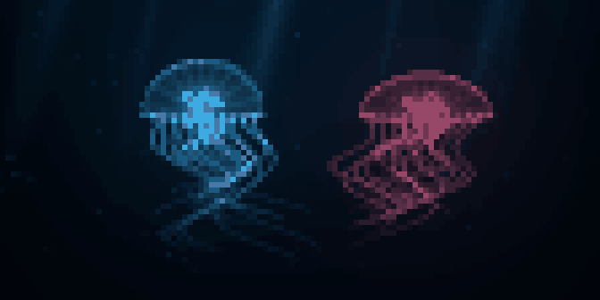
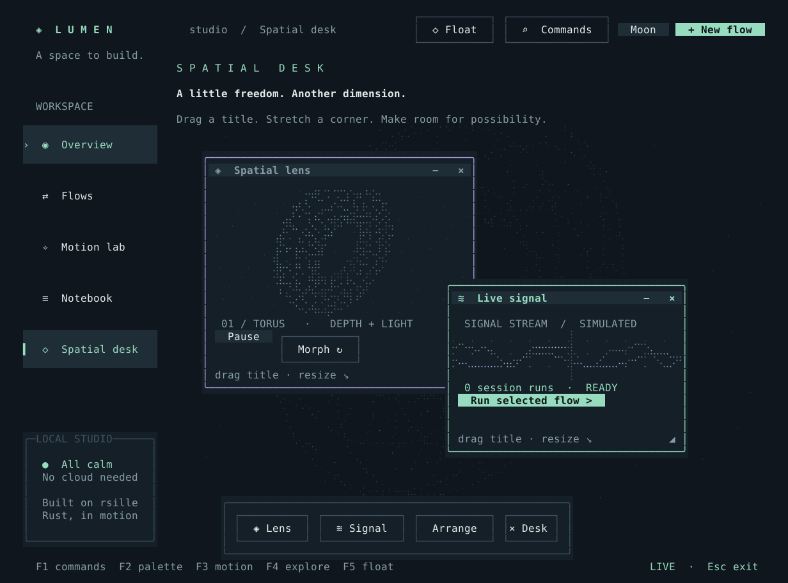
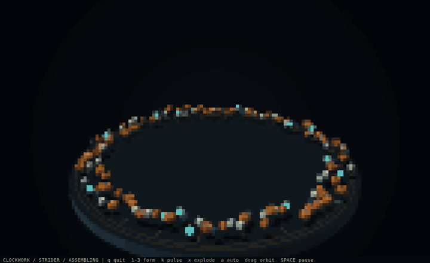
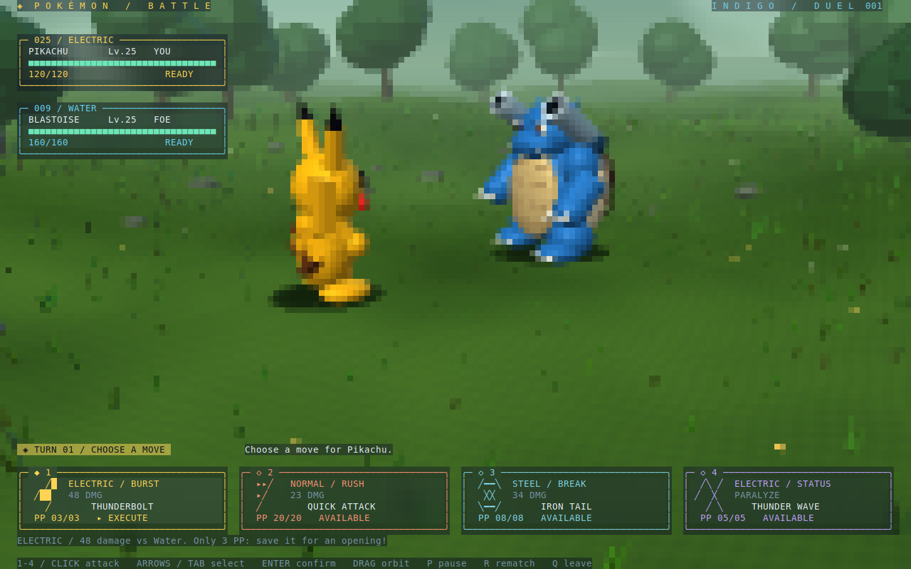
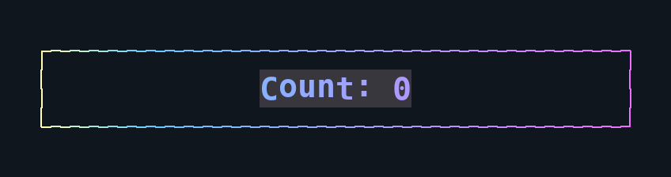

# rsille

English · [中文](README_cn.md)


**Make your terminal come alive.**

Draw a glowing ocean, bring a mechanical creature to life, or combine draggable
windows and 3D scenes in one terminal. **rsille is a Rust framework for terminal applications and
graphics**, bringing rendering, TUI, animation and interaction into one composable API.

## One terminal. Many possibilities.

Click a preview for source code, run commands and controls.

| Jellyfish · An ocean in your terminal | Lumen · A workspace you can move around |
| --- | --- |
| [](examples/jellyfish/README.md) | [](examples/lumen/README.md) |
| **Rendering.** Full-color samples, half-block encoding and continuous redraw bring procedural jellyfish, soft light shafts and drifting particles to life. | **TUI.** Canvas graphics and native widgets share a layout. Drag, resize, collapse and restore windows, with focus management and a command palette. |

| Clockwork · Parts that assemble themselves | Pokémon Battle · Take your turn |
| --- | --- |
| [](examples/clockwork/README.md) | [](examples/pokemon-battle/README.md) |
| **Animation.** The example uses springs to drive 132 parts between three forms; rsille handles frame rendering and input. Orbit the camera while the machine rebuilds. | **Graphics × TUI × interaction.** A 3D scene with native move buttons, health bars and frosted backdrops. Click to attack, drag to orbit and watch the action unfold. |

Previews are exported from rendered terminal cells; Clockwork's GIF is sped up.
The examples supply scenes and simulation; rsille handles the canvas,
encoding, widgets, rendering and event loop.

## Big visuals. Small building blocks.


- **Put effects on your widgets.** Wrap a button, panel or canvas in `visual(...)`.
  Chain gradients, light sweeps, dissolves and waves; add a frosted backdrop or an
  enter/exit transition. The runtime drives the animation.
- **Draw a world inside your UI.** Use Braille, half blocks or quadrants for colored
  graphics. Embed a `canvas(...)` in a layout, with world coordinates and matching
  pointer transforms, or use the renderer directly for a whole scene.
- **Keep the application code simple.** Describe the UI in `view`, change state in
  `update`. Compose Flex/Grid layouts, text editors, tables and draggable windows;
  let the runtime handle focus, input, background tasks and cleanup.

Explore the **[example gallery](examples/README.md)**: a
[voxel sandbox](examples/minecraft/README.md),
[a file manager with drag and drop](examples/orbit-files/README.md) and
[a seven-page widget showcase](examples/tui-showcase/README.md).
For one API at a time, start with the [small TUI examples](packages/tui/examples/README.md).

## Add rsille to an application

To use this checkout from another project, add a path dependency, replacing the path
with the location of your clone:

```toml
[dependencies]
rsille = { path = "../rsille" }
```

The public package is `rsille`. The repository's `tui`, `render` and `canvas` crates
are private development targets, all with `publish = false`.

Default features are empty. Enable `syntax-highlighting` for Syntect highlighting in
code viewers:

```toml
[dependencies]
rsille = { path = "../rsille", features = ["syntax-highlighting"] }
```

Without that feature, code viewers still support plain text and navigation.

## Your first application, already animated

```rust,no_run
use std::time::Duration;
use rsille::tui::prelude::*;

fn main() -> WidgetResult<()> {
    let exit = App::new(0_u32)
        .mode(Mode::Inline)
        .update(|count, (), _ctx| *count += 1)
        .view(|count| {
            visual(
                button(format!("Count: {count}"))
                    .variant(ButtonVariant::Ghost)
                    .on_click(|| ()),
            )
                .gradient(
                    Color::Rgb(70, 220, 255),
                    Color::Rgb(240, 110, 255),
                    GradientDirection::Horizontal,
                )
                .highlight_sweep()
                .animation(looping_visual_spec(Duration::from_secs(2)))
        })
        .run()?;

    println!("Final count: {}", exit.state);
    Ok(())
}
```



Exported from the code above at 32 × 3 terminal cells, replaying Enter to count from 0 to 2.


A clickable counter with a cyan-to-magenta gradient and a looping light sweep.
The three chained calls add the look and motion; no manual frame loop is needed.
`visual(...)` wraps the interactive button, so it keeps its input behavior.

Tab moves focus, Enter or Space activates the button, and Esc exits by default.
`view` describes widgets from state; their messages reach `update`. The third update
argument, `UpdateCtx`, schedules work, emits messages and requests exit with
`ctx.exit()`.

Configure themes, hotkeys, subscriptions and timing before `.update()`. Fullscreen is
the default; `Mode::Inline` uses the normal terminal screen. `run()` returns an
`AppExit` containing the final state and exit reason after cleanup. Inside an existing
Tokio runtime with I/O and time enabled, use `.run_async().await`.

## Test without a terminal

The same builder can produce an in-memory runtime:

```rust
use rsille::tui::prelude::*;

let mut runtime = App::new(0_u32)
    .update(|count, (), _ctx| *count += 1)
    .view(|count| button(format!("Count: {count}")).on_click(|| ()))
    .build()
    .size(40, 3);

runtime.handle().send(()).unwrap();
runtime.step(&[]).unwrap();
assert_eq!(*runtime.state(), 1);
assert_eq!(runtime.frame().size().width, 40);
```

Use `step(&events)` to replay input and `frame()` to inspect rendered cells.
`ManualClock` and `ManualExecutor`, imported from `rsille::tui::runtime`, make timers
and queued jobs controllable. The [workflow example](packages/tui/examples/basics/workflow.rs)
checks Unicode editing, debounce, background saving and exit using one application:

```bash
cargo run -p tui --example workflow -- --headless
```

## Draw with Canvas

**More detail in every character cell.** `Encoding::Quadrant` divides each terminal
cell into **2 × 2 sample positions**. Quadrant characters combine foreground and
background colors to draw finer shapes within a small terminal area.
120 × 20 cells give you a 240 × 40 sample grid.

[](examples/ai-babies/README.md)

Actual Canvas output from [AI Babies' static mode](examples/ai-babies/README.md),
using just **20 terminal rows**. The preview is enlarged with terminal cell proportions
preserved so you can see the detail.

```bash
cargo run --release --manifest-path examples/ai-babies/Cargo.toml -- --static --height 20
```

Use the renderer directly when a widget tree is unnecessary:

```rust,no_run
use rsille::{canvas::Canvas, render};

fn main() -> std::io::Result<()> {
    let mut canvas = Canvas::new();
    for x in 0..160 {
        let x = x as f64;
        canvas.set(x, 15.0 + (x / 10.0).sin() * 10.0);
    }
    render::Builder::new()
        .size((80, 10))
        .append_newline(true)
        .build_render(canvas, std::io::stdout())
        .render()
}
```

| Encoding | Samples per terminal cell | Use |
| --- | --- | --- |
| `Encoding::Braille` (default) | 2 × 4 | Dense lines, curves and colored scenes |
| `Encoding::HalfBlock` | 1 × 2 | Two independently colored vertical samples |
| `Encoding::Quadrant` | 2 × 2 | Quadrant shapes, with samples fitted to terminal colors |

Select an encoding with `Canvas::with_encoding(Encoding::Quadrant)`. Drawing coordinates are samples,
with y increasing upward; bounds and output sizes are terminal cells. `set_color`
colors samples and `set_background` fills uncovered areas. Terminal cells have at most
one foreground and one background color, so Braille and quadrant encoding may combine
sample colors.

The TUI `canvas(...)` widget embeds the same graphics in layouts. Its `.viewport(...)`
and `ctx.world(surface)` support world coordinates and matching pointer transforms.
Compare encodings with `cargo run -p tui --example canvas`.

## API and source map

This checkout contains the **v3 API** (`3.0.0` in `Cargo.toml`). For changes from v2,
see the [migration guide](MIGRATION_V3.md).

| Public module | Responsibility | Shared implementation |
| --- | --- | --- |
| `rsille::tui` | Applications, widgets, layout, input and effects | [src/tui](src/tui) |
| `rsille::render` | Buffers, styled Unicode text, drawing and terminal loops | [src/render](src/render) |
| `rsille::canvas` | Sample graphics and terminal encoding | [src/canvas](src/canvas) |

The private crates under `packages/` compile these same sources for separate tests and
examples. There is no duplicated implementation. Generate API documentation locally:

```bash
cargo doc -p rsille --all-features --no-deps --open
```

Text editing uses grapheme clusters; glyph widths and appearance still depend on the
terminal and font. Held-key applications can opt into `KeyboardMode::Auto` and inspect
`InputEvent::Capabilities`; accurate key releases and independent simultaneous holds
require terminal support. See [Minecraft's input notes](examples/minecraft/README.md).

## Development

```bash
cargo test --workspace
cargo test --workspace --all-features
cargo check --workspace --all-targets --all-features
```

Standalone projects in `examples/` are excluded from the root workspace. Run their
checks separately using `--manifest-path`; commands are in each example's README.

`python3 scripts/check-release.py --offline` checks the self-contained package archive
and an independent consumer without uploading anything. It requires Python 3.12+ and
cached dependencies; omit `--offline` to allow dependency downloads.

[Example gallery](examples/README.md) · [TUI examples](packages/tui/examples/README.md) ·
[Migration guide](MIGRATION_V3.md) · [MIT license](LICENCE)
