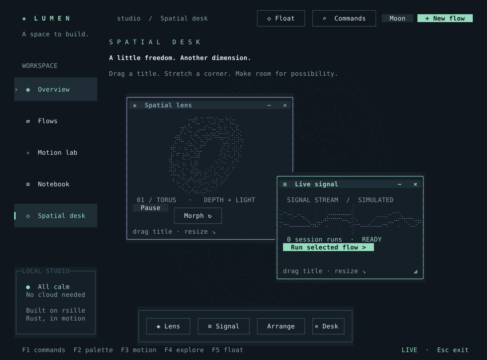
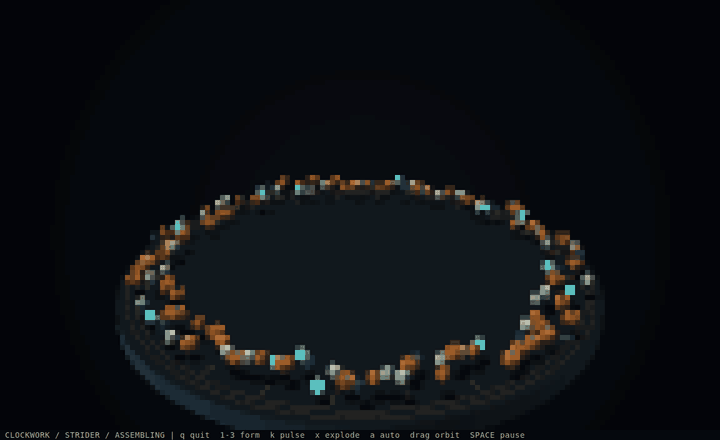
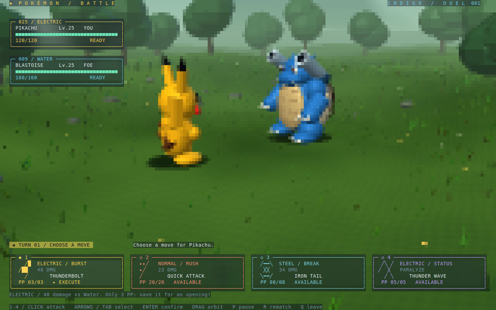
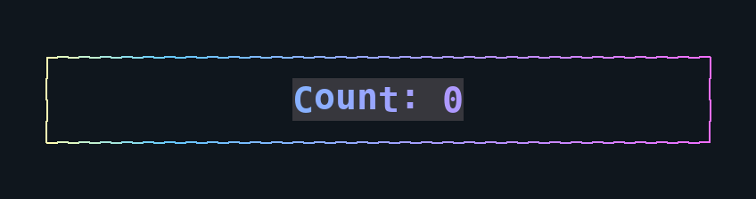
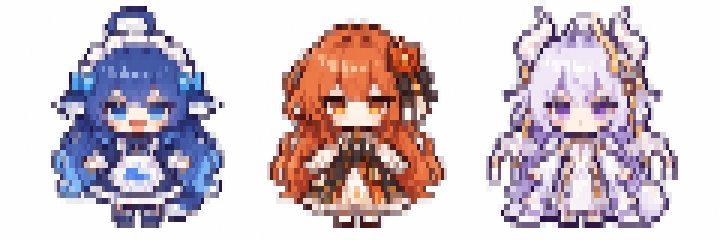

# rsille

English · [中文](README_cn.md)


**Make your terminal come alive.**

**rsille is a Rust framework for terminal applications and graphics**, combining
widget layouts, colorful graphics, animated effects and keyboard/mouse interaction
in one API. Draw character graphics with Unicode Canvas or pixel images with Sixel;
compose canvases, editors, tables and floating windows into one application.
Build anything from an inline tool to a fullscreen workspace without wiring up
separate rendering and event loops.

## One terminal. Many possibilities.

| Pixel-level graphics · Sixel | Desktop-style layouts · TUI |
| --- | --- |
| [](packages/rsille-playground/function-plotter/README.md) | [](examples/lumen/README.md) |
| **Graphics beyond character shapes.** RGB pixel canvases output through Sixel, with layout, clipping, scrolling and opaque coverage. Embed fine curves, images and custom visualizations in your UI on compatible terminals. | **More than fixed panels.** Compose editors, tables and canvases with Flex/Grid layouts. Draggable, resizable, collapsible windows, focus management and command palettes let you build multi-pane workspaces. |

| Continuous animation · Unicode Canvas | Graphics and widgets · Shared interaction |
| --- | --- |
| [](examples/clockwork/README.md) | [](examples/pokemon-battle/README.md) |
| **Character cells can carry moving scenes.** Braille, half-block and quadrant encodings support colorful sampled graphics. Frame updates and input handling let you present procedural animation and your own projected 3D scenes, not just static charts. | **A canvas is part of the interface.** Graphics, buttons and status bars share layout and event handling, with matching world coordinates and pointer transforms. Add gradients, light sweeps, frosted backdrops and transitions to make visualizations interactive as well as visual. |

Function Plotter is an offline RGB preview, not a terminal recording; it excludes
Sixel quantization and refresh behavior. Other previews are exported from rendered
terminal cells; Clockwork's GIF is sped up.
The examples supply scenes and simulation; rsille handles the canvas,
encoding, widgets, rendering and event loop.

## Big visuals. Small building blocks.


- **Describe the UI, not the event loop.** `view` describes widgets; `update` handles
  messages and state. The runtime manages focus, input, background tasks and cleanup.
- **Compose effects without rewriting widgets.** `visual(...)` adds gradients,
  light sweeps, dissolves and waves to character-based widgets while preserving
  interaction. The runtime drives built-in visual animations—no manual frame loop.
- **Choose how your app lives in the terminal.** Use fullscreen for a complete
  workspace or inline for the normal terminal screen. Use Canvas and the renderer
  directly when you do not need a widget tree.
- **Test interaction and async logic without a terminal.** Replay input and inspect
  rendered frames in memory. Control timers and background tasks with a manual
  clock and executor.
- **Draw over the shell you already use.** [rsille-overlay](packages/rsille-overlay/README.md)
  runs your shell in a PTY and floats widgets or images over it, reacting to the
  commands you run. `rsille pet` is built on it.

The **[example gallery](examples/README.md)** includes a
[voxel sandbox](examples/minecraft/README.md),
[a file manager with drag and drop](examples/orbit-files/README.md) and
[a seven-page widget showcase](examples/tui-showcase/README.md).

## Develop with an AI coding agent

The [rsille skill](https://github.com/nidhoggfgg/rsille.skills/blob/main/rsille/SKILL.md)
teaches coding agents the v3 API: widgets, layouts, background tasks, input,
Canvas graphics, animation and headless testing. It includes a
[component catalog](https://github.com/nidhoggfgg/rsille.skills/blob/main/rsille/references/components.md)
and a standalone application starter.

```bash
npx skills add nidhoggfgg/rsille.skills --skill rsille
```

## Try the terminal playground

Download the executable for your system from the [Playground releases](https://github.com/nidhoggfgg/rsille/releases?q=rsille-playground-v) (versions after 0.1.2). On Linux or macOS, rename it to `rsille`, run `chmod +x rsille`, then `./rsille --help`. On Windows, run `.\rsille.exe --help` in PowerShell. To build from the repository, run `cargo run -p rsille-playground`. See the [playground guide](packages/rsille-playground/README.md).

## Installation

```toml
[dependencies]
rsille = "3.3.1"
```

The default `raster` feature provides `RasterCanvas`, the `raster_canvas` widget,
and Kitty and Sixel output. For text and character canvases only, set
`default-features = false`.

For syntax highlighting, add the
[`rsille-syntect` extension](packages/rsille-syntect/README.md) and pass
`rsille_syntect::highlight(source, "rs")` to `CodeViewer::from_lines`.

## An animated application

```rust,no_run
use std::time::Duration;
use rsille::tui::prelude::*;

fn main() -> WidgetResult<()> {
    let exit = App::new(0_u32)
        .mode(Mode::Inline)
        .update(|count, (), _ctx| *count += 1)
        .view(|count| {
            visual(
                button(format!("Count: {count}"))
                    .variant(ButtonVariant::Ghost)
                    .on_click(|| ()),
            )
                .gradient(
                    Color::Rgb(70, 220, 255),
                    Color::Rgb(240, 110, 255),
                    GradientDirection::Horizontal,
                )
                .highlight_sweep()
                .animation(looping_visual_spec(Duration::from_secs(2)))
        })
        .run()?;

    println!("Final count: {}", exit.state);
    Ok(())
}
```



## Graphics: Unicode Canvas and Sixel

**More detail in every character cell.** Unicode Canvas supports colorful sampled
graphics, either on its own or embedded in TUI layouts. Quadrant encoding divides
each cell into **2 × 2 sample positions**, combining foreground and background
colors for finer shapes: 120 × 20 cells provide a 240 × 40 sample grid.

[](packages/rsille-playground/ai-babies/README.md)

Actual Canvas output from [AI Babies' static mode](packages/rsille-playground/ai-babies/README.md),
using just **20 terminal rows**. The enlarged preview preserves terminal cell proportions.

| Encoding | Samples per terminal cell | Use |
| --- | --- | --- |
| `Encoding::Braille` (default) | 2 × 4 | Dense lines, curves and colored scenes |
| `Encoding::HalfBlock` | 1 × 2 | Two independently colored vertical samples |
| `Encoding::Quadrant` | 2 × 2 | Quadrant shapes, with samples fitted to terminal colors |

**Sixel support takes terminal graphics beyond character shapes.**
Present fine curves, colorful images and rich visualizations in Sixel-capable
terminals, alongside text, buttons and other widgets in one interface.

For managed fullscreen apps, opt in with `.raster_backend(RasterBackend::Auto)`
before `.update(...)`. Startup prefers Kitty, then Sixel. Explicit `Kitty` or `Sixel` selections
report startup errors immediately. Auto allows text frames until an image is needed.
Kitty retains full RGB and transparency and reuses uploaded surfaces during drags.
Negotiation uses the controlling terminal on Unix and the console on Windows.
Hosts with custom writers can pass a verified `RasterSession`. Fullscreen
Sixel requires graphics erasure with ED 2, stable palettes, transparent padding
and positioned output without scrolling. Inline Sixel uses `.raster_output(...)`
with explicit row-erasure and scrolling capabilities. Inline apps can also use
`RasterBackend::Auto.negotiate_inline(...)` before input starts and pass the
result to `.inline_raster_session(...)`. Inline Auto prefers Kitty and falls back to advertised Sixel.
The probe checks protocol support. Row-local graphics erasure, image scrolling
and safe positioned output depend on the terminal.

## Extension: Typst math

The independent [`rsille-typst` extension](packages/rsille-typst/README.md) renders
Typst math syntax to a `RasterCanvas` for display in compatible Sixel terminals,
without adding Typst dependencies to the core crate.


## API and resources

The `rsille` crate re-exports `rsille-tui`, `rsille-render` and `rsille-canvas`. You can also depend directly on any of the three packages.

| Public module | Responsibility | Source |
| --- | --- | --- |
| `rsille::tui` | Applications, widgets, layout, input and effects | [rsille-tui](packages/rsille-tui) |
| `rsille::render` | Buffers, styled Unicode text, drawing and terminal loops | [rsille-render](packages/rsille-render) |
| `rsille::canvas` | Sample graphics and terminal encoding | [rsille-canvas](packages/rsille-canvas) |
| `rsille::raster` | RGB raster canvases, Sixel output and capability configuration | [rsille-render/src/raster](packages/rsille-render/src/raster) |

- [Example gallery](examples/README.md)
- [TUI examples](packages/rsille-tui/examples/README.md)
- [Canvas debugging and raster backend comparison](examples/canvas/README.md)
- [MIT license](LICENCE)
