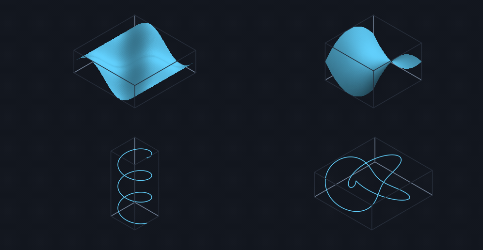
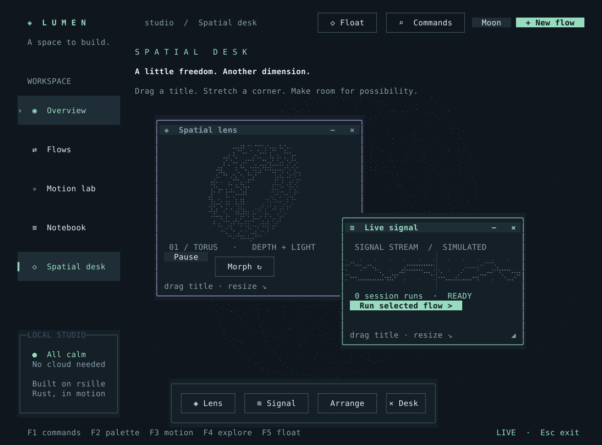
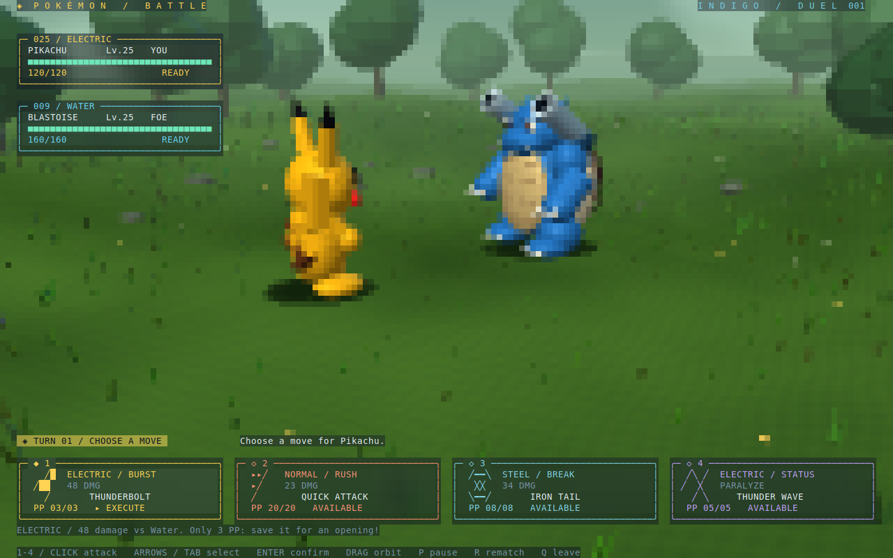
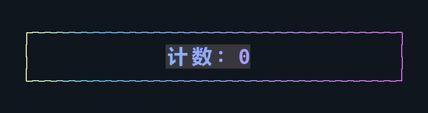

# rsille

[English](README.md) · 中文

[](https://crates.io/crates/rsille)
[](https://docs.rs/rsille)
[](LICENCE)
[](#10-秒体验)


**让你的终端，真正活起来。**

把一只会互动的终端宠物或可点击的小挂件，**直接浮在你正在使用的 shell 上**（甚至在 `vim` 里也能继续互动）；在命令行里直接画出旋转的三维函数曲面；或者用 Rust 构建带浮窗、特效与像素图形的现代 TUI 工作台——跨 **Linux、macOS 与原生 Windows**，全部由同一套框架驱动。

## 一个终端，可以有多少种模样？

| 像素级图形 · Kitty 与 Sixel | 桌面式布局 · TUI |
| --- | --- |
| [](packages/rsille-playground/function-plotter/README_cn.md) | [](examples/lumen/README_cn.md) |
| **图形不再受字符形状限制。** RGB 像素画布通过 Kitty 或 Sixel 输出，支持布局、裁剪、滚动与不透明遮挡；将精细曲线、3D 绘图、图像与数学公式自然嵌入界面。 | **终端界面不必只有固定面板。** 用 Flex/Grid 组合编辑器、表格、目录树与画布；支持可拖动、可缩放、可收起的浮窗，配合焦点管理与命令面板构建多区域工作台。 |

| 连续动画 · Unicode Canvas | 图形与组件 · 同一套交互 |
| --- | --- |
| [](examples/clockwork/README_cn.md) | [](examples/pokemon-battle/README_cn.md) |
| **字符格也能承载动态场景。** 盲文、半块与四分块编码让任意真彩色终端都能流畅呈现程序化动画与三维投影场景。 | **画布不是界面里的孤岛。** 图形与按钮、状态条共用同一套布局和事件系统，世界坐标与指针转换一致，还可叠加渐变、扫光、毛玻璃与过渡动画。 |

*Function Plotter 为离线 RGB 预览，非终端录屏，不包含 Sixel 量化与终端刷新行为；其余预览由渲染后的终端字符格导出，Clockwork 的 GIF 做了加速。场景和模拟逻辑由示例提供，`rsille` 负责画布、编码、组件、渲染与事件循环。*

浏览完整的 **[示例目录](examples/README_cn.md)**，还有[第一人称方块沙盒](examples/minecraft/README_cn.md)、[支持拖放的文件管理器](examples/orbit-files/README_cn.md)、[视错觉解谜游戏](examples/folded-harbor/README_cn.md)和[七页组件展厅](examples/tui-showcase/README_cn.md)。

## 10 秒体验

想立刻在自己的终端里上手？不用写一行 Rust 代码，独立的 **`rsille` Playground** 把四个终端互动体验打包进了同一个可执行文件：

| 命令 | 运行后能玩到什么 |
| --- | --- |
| **`rsille pet`** | 在你日常的 shell（`bash`、`zsh`、`fish`、PowerShell）上养一只会游动的小鲸鱼，也可以直接套在任意程序外面（如 `rsille pet -- vim README.md`）。你敲 `git`/`cargo`/`npm` 时它会接话吐槽，能追鼠标、吹泡泡、吃小鱼干，饿了还会啃屏幕上的字符。*（Kitty / Sixel）* |
| **`rsille draw`** | 内联数学函数绘图 REPL：支持 2D 笛卡尔、极坐标、参数曲线与实时旋转的 3D 曲面/空间曲线，还内置 `:grid` 交互式多图排版。*（Kitty / Sixel）* |
| **`rsille ai-babies --animate`** | 三位动态像素角色，支持 `--kitty`、`--sixel`，也支持在任意真彩色终端运行的纯字符四分块模式。 |
| **`rsille jellyfish`** | 用 Unicode 半块字符渲染的深海发光水母水族箱，直接在普通终端屏幕流畅播放。 |

### 直接下载可执行文件（无需安装 Rust）

前往 [Playground 发布列表](https://github.com/nidhoggfgg/rsille/releases?q=rsille-playground-v) 下载对应平台的可执行文件（提供 Linux `x64`/`ARM64`、macOS `Apple 芯片`/`Intel`、Windows `rsille.exe`；Windows Terminal 1.22+ 开箱支持 Sixel）：

```sh
# Linux / macOS（以 Linux x64 为例）
mv rsille-linux-x64 rsille && chmod +x rsille
./rsille pet
```

```powershell
# Windows（在 Windows Terminal 1.22+ 的 PowerShell 中运行）
.\rsille.exe pet -- powershell.exe -NoLogo
```

### 或通过 Cargo 安装

```sh
cargo install rsille-playground --locked
rsille pet          # 启动 shell 宠物（随时按 Ctrl+] 退出）
rsille draw         # 启动内联 2D/3D 函数绘图器
rsille jellyfish    # 观看终端深海水母
```

在仓库根目录也可以直接 `cargo run -p rsille-playground -- pet` 运行。自定义宠物台词、组合 `--features` 与更多玩法详见 [Playground 使用指南](packages/rsille-playground/README.md) 和 [DeepSeek 终端宠物说明](packages/rsille-playground/deepseek-pet/README.md)。

## 直接在你正在用的 shell 上作画（`rsille-overlay`）

大多数终端框架只能接管整个屏幕。**`rsille-overlay`** 会在 Unix PTY 或 Windows ConPTY 中运行你原本的 shell（或任意程序），原样透传输出，把可交互的 TUI 组件或 Kitty/Sixel 图像直接浮在上面；叠加层移动或隐藏时，被遮挡的文字会自动补回。

- **感知你的 shell 活动**：为 `bash`、`fish`、`zsh` 提供会话级钩子，实时捕获 `Prompt`、`Edit`、`Exec`、`Done`、`Read` 事件。
- **真正可交互的终端挂件**：直接复用 `rsille-tui` 组件——支持拖动标题栏移动面板（`draggable_title`）、点击向 shell 发送命令（`Session::run_with_input`）、切入全屏程序时自动隐藏（`primary_screen_only`），或在 Kitty 会话里连 `vim`/`top` 上方也能继续点按。
- **原生跨平台**：Linux / macOS / WSL 使用 PTY，Windows 10（1809+）使用原生 ConPTY。`rsille pet` 正是基于 `rsille-overlay` 构建。

在仓库根目录直接体验内置的 shell 叠加层示例：

```sh
cargo run -p rsille-overlay --example folder_tree    # 可拖动的浮动目录树，选中目录一键 "cd here"
cargo run -p rsille-overlay --example todolist       # 浮在 shell 角落的待办清单
cargo run -p rsille-overlay --example yes_engineer   # 一键向终端发送 "yes, continue" 的确认按钮
cargo run -p rsille-overlay --example status_badge   # 实时显示上一条命令退出状态的徽章
```

随时按 **Ctrl+]** 退出叠加层会话。完整说明与自定义 `Overlay` 写法见 [rsille-overlay 文档](packages/rsille-overlay/README_cn.md)。

## 背后是一套顺手的 Rust 框架


在这些演示背后，**`rsille`** 把组件布局、彩色图形、动画特效、shell 叠加层和键鼠交互统一进了一套简洁的 Rust API：

- **声明界面，不手写事件循环。** `view` 描述组件，`update` 处理消息与状态；运行时统一管理焦点、指针手势、后台任务、主题与退出清理。
- **组合特效，不重写组件。** `visual(...)` 可直接给字符组件叠加渐变、扫光、溶解与波浪特效，同时保留完整交互；内置视觉动画由运行时自动驱动。
- **三种方式融入终端。** 全屏构建完整工作台、`Mode::Inline` 留在普通终端滚动历史中，或通过 `rsille::overlay` 直接浮在 live shell 之上；不需要组件树时，也可以单独使用 `Canvas` 和 `render`。
- **无终端自动化测试。** 不依赖真实 TTY 即可在内存中步进运行时、回放输入、检查渲染帧，并用 `ManualClock` 与 `ManualExecutor` 精确控制计时器和异步任务。

## 快速上手

在 `Cargo.toml` 中引入 `rsille`：

```toml
[dependencies]
rsille = "3.4.1"
# 可选：启用 live shell 叠加层（重新导出 rsille-overlay）
# rsille = { version = "3.4.1", features = ["overlay"] }
# 仅使用文本与 Unicode 字符画布（不引入像素图形支持）：
# rsille = { version = "3.4.1", default-features = false }
```

### 第一个应用，就带动画

```rust,no_run
use std::time::Duration;
use rsille::tui::prelude::*;

fn main() -> WidgetResult<()> {
    let exit = App::new(0_u32)
        .mode(Mode::Inline)
        .update(|count, (), _ctx| *count += 1)
        .view(|count| {
            visual(
                button(format!("计数：{count}"))
                    .variant(ButtonVariant::Ghost)
                    .on_click(|| ()),
            )
            .gradient(
                Color::Rgb(70, 220, 255),
                Color::Rgb(240, 110, 255),
                GradientDirection::Horizontal,
            )
            .highlight_sweep()
            .animation(looping_visual_spec(Duration::from_secs(2)))
        })
        .run()?;

    println!("最终计数：{}", exit.state);
    Ok(())
}
```



### 在 shell 右上角浮一个可交互挂件

开启 `features = ["overlay"]` 后，任意 `rsille::tui` 应用都能浮在正在使用的 shell 上，并响应你执行的命令：

```rust,no_run
use rsille::overlay::{Anchor, Session, ShellEvent, WidgetOverlay};
use rsille::tui::prelude::*;

fn main() -> std::io::Result<()> {
    let app = App::new(String::new())
        .update(|last: &mut String, msg: Option<String>, _ctx| *last = msg.unwrap_or_default())
        .view(|last: &String| {
            row::<Option<String>>()
                .child(label(last.clone()).width(20))
                .child(button("×").on_click(|| None))
        })
        .build();

    let overlay = WidgetOverlay::new(app, (24, 1))
        .anchor(Anchor::TopRight)
        .on_shell(|event| match event {
            ShellEvent::Exec(line) => Some(Some(line.to_owned())),
            _ => None,
        });

    Session::new().mouse(true).run(overlay)?;
    Ok(())
}
```

## 图形能力：Unicode Canvas、Kitty 与 Sixel

### Unicode Canvas（任意真彩色终端可用）

`Canvas` 既可独立绘图，也能直接嵌入 TUI 布局。`Encoding::Quadrant` 将每个字符格细分为 **2 × 2 个采样点**并拟合前景色与背景色——仅 120 × 20 字符格就能呈现 240 × 40 的像素轮廓。

[](packages/rsille-playground/ai-babies/README_cn.md)

*上图为 [AI Babies 静态模式](packages/rsille-playground/ai-babies/README_cn.md) 的实际 Canvas 输出，仅占 **20 行**；预览按字符格比例放大以便查看细节。*

| 编码 | 每格采样数 | 适用场景 |
| --- | --- | --- |
| `Encoding::Braille` *（默认）* | 2 × 4 | 密集线条、曲线与动态 3D 线框/场景 |
| `Encoding::HalfBlock` | 1 × 2 | 上下独立着色的平滑渐变与像素场景（如 `rsille jellyfish`） |
| `Encoding::Quadrant` | 2 × 2 | 轮廓清晰的像素角色与图形，自动拟合终端配色 |

### 像素级图形：Kitty 与 Sixel

默认启用的 `raster` feature 提供 `RasterCanvas`、`raster_canvas` 组件，以及跨 **Linux、macOS、WSL 和原生 Windows** 的 **Kitty** 与 **Sixel** 输出：

- **Kitty 图形协议**：保留完整 24 位 RGB 与透明通道，拖动时直接复用已上传图像，同时支持全屏与内联模式，在叠加层中即使切进 `vim` 等全屏程序也能保持可见与可交互。
- **Sixel 图形协议**：终端覆盖广（包括 **Windows Terminal 1.22+**），支持布局、裁剪与不透明遮挡。
- **自动协商**：全屏应用调用 `.raster_backend(RasterBackend::Auto)`，内联应用调用 `RasterBackend::Auto.negotiate_inline(...)`——启动时自动探测终端能力，优先选用 Kitty，不支持时回退 Sixel。

关于协议细节、内联 Sixel 能力要求及自定义 `RasterSession`，详见 [Canvas 调试与图像后端对照](examples/canvas/README_cn.md)。

## 配合 AI 编程助手开发

[rsille skill](https://github.com/nidhoggfgg/rsille.skills/blob/main/rsille/SKILL.md) 让 AI 编程助手直接掌握 v3 API——涵盖组件与布局、后台任务、输入处理、Canvas 图形、动画特效与无终端测试，附带[组件索引](https://github.com/nidhoggfgg/rsille.skills/blob/main/rsille/references/components.md)和可独立运行的应用模板：

```bash
npx skills add nidhoggfgg/rsille.skills --skill rsille
```

## 包生态与扩展

`rsille` 统一重新导出 `rsille-tui`、`rsille-render`、`rsille-canvas`，以及（开启 `overlay` feature 时的）`rsille-overlay`。你可以直接引入 `rsille`，也可以按需单独依赖子包和独立扩展：

| Crate / 模块 | 职责 | 入口 |
| --- | --- | --- |
| `rsille` | 聚合入口（`tui`、`render`、`canvas`、`raster`，可选 `overlay`） | [src/lib.rs](src/lib.rs) |
| `rsille-tui` / `rsille::tui` | 状态化应用、组件、Flex/Grid 布局、焦点、手势、特效与无终端运行时 | [packages/rsille-tui](packages/rsille-tui) |
| `rsille-render` / `rsille::render` | Buffer、带样式的 Unicode 文本、Kitty/Sixel 栅格输出与终端循环 | [packages/rsille-render](packages/rsille-render) |
| `rsille-canvas` / `rsille::canvas` | 盲文、半块与四分块彩色采样图形 | [packages/rsille-canvas](packages/rsille-canvas) |
| `rsille-overlay` / `rsille::overlay` | 在 Unix PTY / Windows ConPTY 实时 shell 上浮动组件与 Kitty/Sixel 图像 | [packages/rsille-overlay](packages/rsille-overlay/README_cn.md) |
| `rsille-syntect` | 基于 Syntect 的 `CodeViewer` 代码高亮扩展（`CodeViewer::from_lines`） | [packages/rsille-syntect](packages/rsille-syntect/README.md) |
| `rsille-typst` | 进程内将 Typst 数学公式渲染为 `RasterCanvas`，不向核心引入 Typst 依赖 | [packages/rsille-typst](packages/rsille-typst/README_cn.md) |
| `rsille-playground` | 独立的 `rsille` 命令行体验包（内置 `pet`、`draw`、`ai-babies`、`jellyfish`） | [packages/rsille-playground](packages/rsille-playground/README.md) |

## 更多资料

- [示例目录](examples/README_cn.md) — 完整应用、游戏与三维演示
- [TUI 组件小示例](packages/rsille-tui/examples/README_cn.md) — 单个组件与运行时特性的精简示例
- [Canvas 调试与图像后端对照](examples/canvas/README_cn.md) — Kitty 与 Sixel 行为对照及排查指南
- [MIT 许可](LICENCE)
