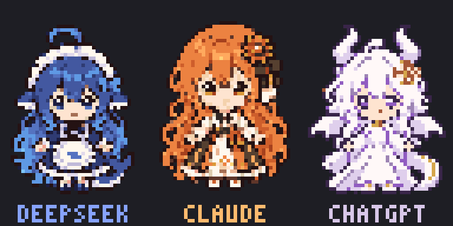

# AI Babies / AI 幼崽待机

按 `x/` 中三张 Q 版参考图制作的终端像素角色：DeepSeek 蓝发鲸尾女仆、
Claude 橙色长发太阳花女孩、ChatGPT 白紫色小龙女孩。
三人只在原位轻轻起伏、眨眼、弹跳，没有战斗和追逐。
这是独立示例，`ai-rumble` 保持原样。

```sh
cargo run --release --manifest-path examples/ai-babies/Cargo.toml
```



默认 inline 播放，最多 32 行，推荐 **128×32** 或更大的 True Color 终端。
使用 Unicode Half-block，一个字符显示上下两个彩色像素，不需要终端图片协议。
窗口缩小时自动按比例缩小；80×24 可以展示三人，但细节会减少。

| 按键 | 操作 |
| --- | --- |
| `1` / `2` / `3` | 单独查看 DeepSeek / Claude / ChatGPT |
| `0` | 回到三人同屏 |
| 空格 | 暂停 / 继续 |
| `q` / Esc / Ctrl+C | 退出 |

## 素材与实现

- [当前透明精灵源图](assets/source-v7.png)由内置 imagegen 参考用户提供的
  `x/deepseek.png`、`x/claude.png`、`x/chatgpt.png` 生成，属于非官方拟人形象。
  保留蓝发女仆的白色头饰与鲸尾、橙色长发女孩的太阳花发饰与黑白裙装、
  白紫色小龙女孩的双角、翅膀与龙尾。参考图目录 `x/` 仅在本地保留；
  重新打包使用已保存的源图，无需依赖该目录。
  当前版本保留紧凑的彩色眼睛、单点高光和蓝／琥珀／紫色瞳孔，去掉腮红，
  使用最近邻缩小，避免高光与肤色混合。
  DeepSeek 的下颌逐级收窄，形成圆润的下巴；ChatGPT 使用大块白色与浅紫色，
  减少服饰碎纹和金色装饰。Claude 继续从 `source-v6.png` 打包，保持已确认的外观。
  `concept.png`、`source.png`、`source-v2.png` 是此前帽子造型的历史素材，不再用于运行时。
- `tools/pack_sprites.py` 把透明源图分成三人，保持宽高比缩至 `40×48` 画布，
  DeepSeek、Claude 各用 17 色固定调色板，ChatGPT 使用独立的 8 色调色板，
  二值 alpha，输出 PNG 和原始 RGBA。
  调色板明确保留肤色、棕色嘴线和眼睛高光，避免小面积面部颜色被头发和服饰挤掉。
  生成提示记录在
  [assets/prompt-v3.txt](assets/prompt-v3.txt)和[眼睛修订提示](assets/prompt-v5.txt)，
  [去腮红提示](assets/prompt-v6.txt)记录本次面部清理。
  [轮廓与配色提示](assets/prompt-v7.txt)记录最新修订。
  旧版提示保留在 `assets/prompts.txt`。
- `.rgba` 用 `include_bytes!` 编译进二进制，运行时无需读图片文件、联网、Python 或图片解码库。
  三张素材共 23,040 字节。源图和 PNG 仅供审阅和重新打包。
- 角色绘制尺寸只随窗口大小变化，动画只做整数像素位移，不做呼吸拉伸。
  起伏与跳动保持脸部像素形状不变，仅眨眼时替换眼睛区域。
  待机周期为 8 秒，三人的相位错开。角色主体直接来自生成图片，不用矢量重绘。
- 预览 GIF 来自真正的 `Canvas → Half-block → Buffer` 输出，每个像素最近邻放大 6 倍，
  保留终端分辨率的实际细节；终端字体的字符宽高比可能略有差异。

## 验证与导出

```sh
cargo test --manifest-path examples/ai-babies/Cargo.toml
cargo clippy --manifest-path examples/ai-babies/Cargo.toml --all-targets -- -D warnings
cargo run --release --manifest-path examples/ai-babies/Cargo.toml -- --headless
cargo run --release --manifest-path examples/ai-babies/Cargo.toml -- --snapshot /tmp/ai-babies.ppm 0
cargo run --release --manifest-path examples/ai-babies/Cargo.toml -- --snapshot /tmp/ai-babies-small.ppm 0 80 24
cargo run --release --manifest-path examples/ai-babies/Cargo.toml -- --frames /tmp/ai-babies-frames
```

测试覆盖三人的动画变化与周期复现、多种窗口尺寸、单人模式、暂停和退出，
并逐帧验证整段循环在消除位移后，睁眼／闭眼状态各自的角色像素完全一致。
`--snapshot` 导出终端像素 PPM；`--frames` 导出 8 秒、24 FPS 的 192 帧。
重新打包素材只需 Pillow：`python3 examples/ai-babies/tools/pack_sprites.py`。
