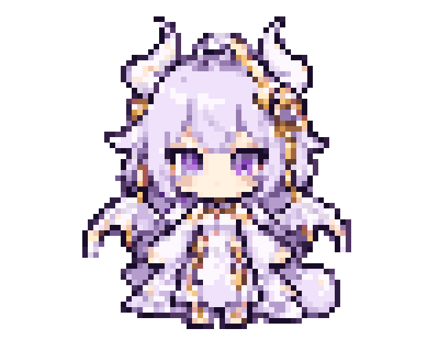
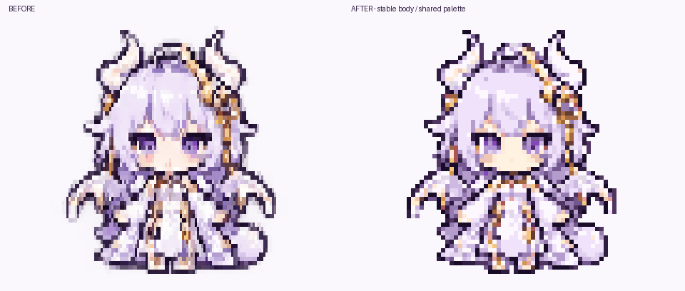

# AI Babies / 单角色动作宠物

参考 [chibi-trio-source.png](assets/chibi-trio-source.png) 右侧的白紫色小龙女孩，
用内置 imagegen 生成 **6 组动作、24 张预制姿态帧**。默认只显示这个角色，
按动作时间表逐帧播放：待机眨眼 → 挥手 → 原地走路 → 跳跃 → 思考 → 睡觉。
完整演示约 17 秒循环；每个动作有独立帧停留时间。

```sh
cargo run --release --manifest-path examples/ai-babies/Cargo.toml
```



动态版使用 `Canvas → Encoding::HalfBlock → Buffer`，每格上下两个采样点的
颜色都能保留，避免四个采样点合并为两种颜色时产生额外色块变化。
按终端字符格宽高 1:2 显示正方形像素。默认 inline 播放，最多 32 行，
只绘制角色的非透明像素，空白和边缘空出的半格沿用终端默认背景，不填白色底板。
推荐 80 列 × 34 行的 True Color 终端（含 shell 提示符）；较小窗口自动缩小。
预览按真实编码后的字符块重建、最近邻放大，具体字体的接缝与比例可能略有差异。

| 按键 | 操作 |
| --- | --- |
| `1` | 待机 / 眨眼 |
| `2` | 挥手 |
| `3` | 原地走路 |
| `4` | 跳跃 |
| `5` | 思考 |
| `6` | 睡觉 |
| `0` | 从头循环展示全部动作 |
| 空格 | 暂停 / 继续 |
| `q` / Esc / Ctrl+C | 退出 |

选择动作会从该动作第一帧重新播放；暂停时切换动作仍保持暂停。

## 稳定性优化对照



这一轮重点优化待机和挥手：共用同一张身体底图，眨眼只替换眼睛，挥手只替换
手臂和必要的表情区域。头发、角、衣服、尾巴等静止部分逐像素相同，
中性姿态也在动作之间复用。所有动作统一使用 24 色基础调色板，加一档专用浅肤色，不抖色，
保留紫色瞳孔、肤色和金色装饰；透明度变为二值，清理近色孤立杂点。
面部按各姿态的位置单独映射肤色，保护眼睛高光和嘴部，避免眼周及下巴的浅肤色
被映射成衣服的白色。全图最多 25 色。这一步是对原素材的确定性处理，没有重新生成角色。

32 行使用直接从源图制作的 64×64 帧，24 行使用独立制作的 48×48 帧，
避免原来的 256 → 96 → 显示尺寸连续缩小。其他窗口尺寸从最近的可用图集
缩小。小窗口的细节会减少；推荐 32 行查看。

对照导出中，中性待机两帧在选定的头顶和下半身区域有 3,080 个输出像素变化，
优化后为 0；测试另外验证静止区域一致，以及 Half-block 编码前后的采样颜色完全一致。
走路、跳跃、思考和睡觉统一了调色板，仍保留原生成的完整姿态变化，
没有把它们的身体强行固定。

## 动作素材与实现

- [生成源图](assets/dragon-actions-source.png)：透明 RGBA，1024×1536，
  4 列 × 6 行，每行一个动作，按上表顺序排列。完整提示保存在
  [dragon-actions-prompt.txt](assets/dragon-actions-prompt.txt)。角色是非官方拟人形象。
- 新图集：[64×64](assets/dragon-actions-v2-64.png) / [48×48](assets/dragon-actions-v2-48.png)。
  固定网格、固定缩放，不逐帧裁切或自动居中，保留起跳和蹲下的相对位置。
- `assets/dragon-actions-v2-{48,64}.rgba`：各 24 帧顺序存储，共 614,400 字节，编译进程序。
  运行时无需联网、图片解码或 Python。
- `src/scene.rs`：动作表规定帧序与停留时长，运行时只取帧、缩放和透明合成。
  每组四个帧槽位，待机复用睁眼帧，属于低帧数像素动画。
- 原生成源图、旧的 96×96 图集、原三人立绘素材均保留；默认动态版使用 v2 图集。

重新打包需要 Pillow：

```sh
python3 examples/ai-babies/tools/pack_actions.py
```

## 验证与导出

```sh
cargo test --manifest-path examples/ai-babies/Cargo.toml
cargo clippy --manifest-path examples/ai-babies/Cargo.toml --all-targets -- -D warnings
cargo run --release --manifest-path examples/ai-babies/Cargo.toml -- --headless
cargo run --release --manifest-path examples/ai-babies/Cargo.toml -- --snapshot /tmp/ai-babies.ppm 0
cargo run --release --manifest-path examples/ai-babies/Cargo.toml -- --snapshot /tmp/ai-babies-small.ppm 3 80 24
cargo run --release --manifest-path examples/ai-babies/Cargo.toml -- --frames /tmp/ai-babies-frames
cargo run --release --manifest-path examples/ai-babies/Cargo.toml -- --action wave /tmp/ai-babies-wave
python3 examples/ai-babies/tools/preview_actions.py /tmp/ai-babies-frames
# 如果保留了优化前的实际终端导出，可重新生成并排对照
python3 examples/ai-babies/tools/preview_actions.py /tmp/ai-babies-frames --compare /tmp/ai-babies-before-frames
```

`--frames` 导出完整动作循环的 409 张 PPM（24 FPS）。`--action` 支持
`idle/wave/walk/hop/think/sleep`，导出单动作的一个循环。请使用新的输出目录，
避免与此前导出的帧混在一起。每张 PPM 配套同名 `.pgm` 透明度掩码，
预览工具读取两者制作透明 PNG/GIF。PPM 本身不支持透明，单独打开时空白显示为黑色；
该黑色不用于终端渲染。`--snapshot` 同样输出配套掩码。
上面的历史并排对照使用统一浅色底板展示，当前主预览为透明背景。
测试覆盖动作变化与帧复用、静止区域一致性、颜色数量与透明度、编码颜色保真、
停留时间、循环与自动切换边界、多种窗口尺寸、暂停、按键切换和退出。

## 静态预览（288×48 → 144 列 × 24 行）

```sh
cargo run --release --manifest-path examples/ai-babies/Cargo.toml -- --static
```

用户提供的原始大图（2172×724）保存在
[assets/chibi-trio-source.png](assets/chibi-trio-source.png)。
此前确认效果的 240×80 小图保存在
[assets/chibi-trio-240x80.png](assets/chibi-trio-240x80.png)，保留原有像素。
两份图片均纳入 Git；打包直接读取小图，无需依赖 `x/` 目录。
渲染时调整为 288×48 采样点，使用最近邻采样保留像素边缘，
再用 `Canvas` 的 `Encoding::Quadrant`（2×2）渲染。按字符格宽高 1:2 补偿
横向尺寸，在终端中保持原图的 3:1 显示比例，默认高度为 24 行。
输出一次后退出，画面留在终端里。终端至少需要 144 列；完整同屏查看建议留出
26 行，包括 shell 提示符。保留原图白底，静态显示。
每个字符格最多两种颜色，由 Canvas 合并四个采样点的颜色。
以下预览采用字符格宽高 1:2，来自实际编码后的终端 Buffer，
按块重建，不模拟具体字体的接缝；实际比例随终端字体设置略有差异。


```sh
# 导出实际编码后的画面（PPM，按终端字符格比例）
cargo run --release --manifest-path examples/ai-babies/Cargo.toml -- --static --snapshot /tmp/ai-babies-static.ppm
# 修改 assets/chibi-trio-240x80.png 后重新打包，需要 Pillow
python3 examples/ai-babies/tools/pack_static.py
```

`assets/chibi-trio-240x80.rgb` 保存小图的 240×80 RGB 字节，编译进二进制；每个高度直接从小图
做最近邻采样和比例补偿，避免多次缩放损失，运行时无需图片解码依赖。

### 自定义高度

可用 `--height ROWS` 指定 1–40 行，宽度自动为高度的 6 倍。

```sh
# 稳妥档：144 列 × 24 行
cargo run --release --manifest-path examples/ai-babies/Cargo.toml -- --static --height 24
# 紧凑档：120 列 × 20 行
cargo run --release --manifest-path examples/ai-babies/Cargo.toml -- --static --height 20
# 导出指定高度
cargo run --release --manifest-path examples/ai-babies/Cargo.toml -- --static --height 20 --snapshot /tmp/ai-babies-20.ppm
```
