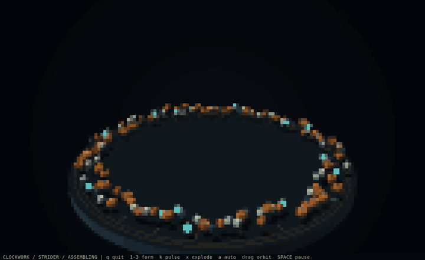

# Clockwork / 发条生物

English · [中文](README_cn.md)

132 brass, steel and porcelain parts assemble into a walking strider, a flapping
ornithopter and an opening mechanical iris. The same parts disassemble and rebuild
as each form, with an optional exploded view and magnetic pulse.



## Run

From the repository root:

```bash
cargo run --release --manifest-path examples/clockwork/Cargo.toml
```

Fullscreen auto-play starts immediately. Use a True Color terminal with half-block
support, preferably 144 × 44; 80 × 24 also works. Each form has an approximately
18-second assembly/activity/disassembly cycle. No image or model assets are loaded.

## Controls

| Input | Action |
| --- | --- |
| 1 / 2 / 3 | Assemble and hold the strider / ornithopter / iris |
| a | Toggle automatic cycling |
| k / right click | Scatter parts with a magnetic pulse |
| x | Toggle exploded view |
| Left drag / arrows | Orbit the camera; disables automatic sway |
| Wheel / + / - | Zoom |
| o / b / h | Toggle camera sway / Half-block or Braille / footer |
| Space / p | Pause simulation; camera controls remain available |
| q / Esc / Ctrl+C | Exit |

## Implementation and checks

[machine.rs](src/machine.rs) defines shared parts, joint targets and damped springs.
Simulation advances at a fixed 120 Hz. This is an animation-oriented spring model with
ground bounce, not a rigid-body or gear-transmission simulation.
[raster.rs](src/raster.rs) draws solid geometry, depth and lighting on the CPU.
`Canvas` encodes the samples; `render::Draw`, `Update` and `Builder` run the terminal loop.
Playback is capped at 30 FPS.

```bash
cargo test --manifest-path examples/clockwork/Cargo.toml
cargo run --release --manifest-path examples/clockwork/Cargo.toml -- --headless
cargo run --release --manifest-path examples/clockwork/Cargo.toml -- --snapshot /tmp/clockwork.svg 2 6
cargo run --release --manifest-path examples/clockwork/Cargo.toml -- --benchmark
```

`--snapshot FILE.svg [auto|1-3] [SECONDS] [block|braille]` exports a 144 × 44 buffer.
Defaults are `auto`, 7 seconds and `block`; time must be 0–180 seconds. Numeric forms
stay locked. Headless checks cover the full cycle and pulse recovery. The benchmark
measures simulation, drawing and encoding, excluding terminal I/O. The GIF is an
accelerated preview, not a measurement of interactive frame rate.

[All examples](../README.md)
