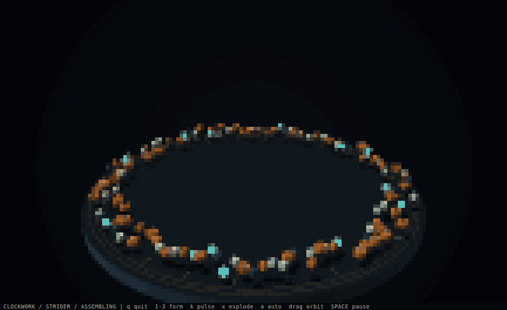

# Clockwork / 发条生物

工作台上散落着 132 个零件。齿轮先起身、骨架逐段对接、活塞与陶瓷护板归位，
一台多足机器开始行走。随后零件退回工作台，重组成一台扑翼飞行器，再变成一朵会呼吸的机械花。

```sh
cargo run --release --manifest-path examples/clockwork/Cargo.toml
```



默认全屏，自动运行完整循环。推荐支持 True Color、Unicode 半块字符的终端和 **144×44** 的窗口；
**80×24** 也可运行。每种形态约 18 秒，依次经过组装、活动、拆解三个阶段。
画面使用黄铜、陶瓷与深色金属，光照、遮挡、投影和平台刻度均实时计算，无图片或模型素材。

## 玩什么

- **多足步行机**：三组左右交错的腿，各有双轨骨架、膝部齿轮和伸缩活塞，脚尖依次抬起落下。
- **扑翼飞行器**：十二根翼肋带着陶瓷羽片上下拍动，核心悬浮，关节随翼面折叠。
- **机械花**：径向齿轮带动十二片花瓣，花蕾收拢、展开，中心传动盘持续旋转。
- **磁力脉冲**：按 `k` 或鼠标右键，零件会向外弹开、下落，再被磁力拉回正在运动的结构。
- **爆炸视图**：按 `x` 拉开零件间距，边运动边观察内部结构，再按一次重新合拢。

| 按键／鼠标 | 操作 |
| --- | --- |
| `1` / `2` / `3` | 重新组装成指定形态，并保持该形态活动 |
| `a` | 开关自动拆解与轮换；手动选形态后可用此键恢复自动播放 |
| `k` / 鼠标右键 | 磁力脉冲，震散后自行重组 |
| `x` | 开关爆炸视图 |
| 鼠标左键拖动 / 方向键 | 转动相机，手动转动后停止自动摆镜 |
| 滚轮 / `+` / `-` | 缩放相机 |
| `o` | 开关缓慢摆镜 |
| `b` | 切换 Half-block／Braille 编码 |
| 空格 / `p` | 暂停／继续模拟；暂停时仍可转动相机 |
| `h` | 隐藏／显示底栏 |
| `q` / Esc / Ctrl+C | 退出并恢复终端 |

## 实现

`src/machine.rs` 保存固定的零件清单、关节目标和弹簧状态。三种形态共享相同的零件编号、材质和齿轮身份，
通过不同的关节布局重组；并非切换三段独立视频。分批组装使用有延迟的弧线路径，归位与打散后的恢复使用
阻尼弹簧，齿轮自转、腿部步态、翼面和花瓣每个模拟步重新计算。

模拟按 **120 Hz 固定步长** 推进，绘图不改变模拟状态。物理是为动画设计的磁力弹簧模型，包含地面回弹，
不模拟齿轮啮合传力或零件间的刚体碰撞。爆炸视图是结构观察效果。

`src/raster.rs` 在 CPU 上绘制实体梁、齿轮齿面、轴心、平台和简化地面投影，使用深度缓冲与金属高光。
默认 Half-block 在光栅化时进行 2×2 超采样，减少细小零件运动时的锯齿；Braille 使用更密的采样网格。
所有颜色交给公开的 `rsille::canvas::Canvas` 编码，`render::Draw`、`Update` 与 `Builder::build_event_loop()`
负责帧绘制、输入、窗口调整和终端恢复。没有使用 TUI 控件或其他渲染框架。

## 验证与帧导出

```sh
cargo test --manifest-path examples/clockwork/Cargo.toml
cargo clippy --manifest-path examples/clockwork/Cargo.toml --all-targets -- -D warnings
cargo run --release --manifest-path examples/clockwork/Cargo.toml -- --headless
cargo run --release --manifest-path examples/clockwork/Cargo.toml -- --snapshot /tmp/clockwork.svg 2 6
cargo run --release --manifest-path examples/clockwork/Cargo.toml -- --snapshot /tmp/clockwork-auto.svg auto 43 braille
cargo run --release --manifest-path examples/clockwork/Cargo.toml -- --benchmark
```

`--snapshot FILE.svg [auto|1-3] [SECONDS] [block|braille]` 从初始状态推进模拟，导出实际 `Draw` 输出的
144×44 字符 Buffer。默认 `auto`、7 秒、Half-block；指定数字时锁定对应形态。秒数范围为 0–180。
导出器用矩形还原半块采样、用圆点还原盲文，避免本地 SVG 字体缺失造成预览失真；底栏仍使用字体。
GIF 从同一套自动模拟的帧导出后缩小、加速制成，不代表实际播放帧率。

测试检查三种形态的零件数量、组装误差、活动、脉冲后的散开与恢复、不同帧率下模拟一致、完整自动循环、
手动锁定、暂停、鼠标转镜与失焦、退出，以及两种编码在多种窗口尺寸下的确定性输出。
`--headless` 推进完整三形态循环并检查打散后的恢复。`--benchmark` 测量 144×44 Half-block 下的模拟、
绘图与编码，预热 10 帧后统计 60 帧的平均及 p95 耗时，不包含终端 I/O；交互播放限制为 30 FPS。
