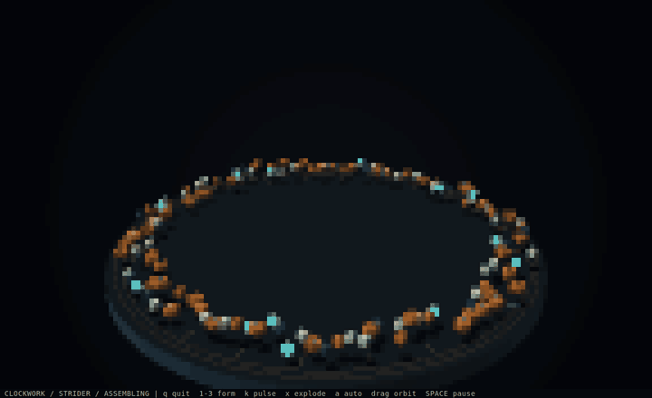

# Clockwork / 发条生物

[English](README.md) · 中文

132 个黄铜、钢和陶瓷零件自动组装成多足步行机、扑翼飞行器和开合的机械花。
同一套零件在不同形态间拆解重组，还可展开爆炸视图或施加磁力脉冲。



## 运行

在仓库根目录执行：

```bash
cargo run --release --manifest-path examples/clockwork/Cargo.toml
```

启动即全屏自动播放。建议使用支持 True Color 和半块字符的终端，推荐 144 × 44，
80 × 24 也能运行。每种形态约 18 秒，经过组装、活动和拆解三个阶段，不加载图片或模型素材。

## 操作

| 输入 | 操作 |
| --- | --- |
| 1 / 2 / 3 | 组装并保持步行机 / 飞行器 / 机械花形态 |
| a | 开关自动轮换 |
| k / 右键 | 磁力脉冲，震散零件 |
| x | 开关爆炸视图 |
| 左键拖动 / 方向键 | 转动相机，并关闭自动摆镜 |
| 滚轮 / + / - | 缩放 |
| o / b / h | 开关摆镜 / 切换 Half-block 与 Braille / 显隐底栏 |
| 空格 / p | 暂停模拟，仍可操作相机 |
| q / Esc / Ctrl+C | 退出 |

## 实现与验证

[machine.rs](src/machine.rs) 定义共用零件、关节目标和阻尼弹簧，以 120 Hz 固定步长推进。
这是包含地面回弹、为动画设计的弹簧模型，不模拟刚体碰撞或齿轮啮合传力。
[raster.rs](src/raster.rs) 在 CPU 上计算实体几何、深度和光照，`Canvas` 编码采样点，
`render::Draw`、`Update` 和 `Builder` 驱动终端循环。播放上限为 30 FPS。

```bash
cargo test --manifest-path examples/clockwork/Cargo.toml
cargo run --release --manifest-path examples/clockwork/Cargo.toml -- --headless
cargo run --release --manifest-path examples/clockwork/Cargo.toml -- --snapshot /tmp/clockwork.svg 2 6
cargo run --release --manifest-path examples/clockwork/Cargo.toml -- --benchmark
```

`--snapshot FILE.svg [auto|1-3] [SECONDS] [block|braille]` 导出 144 × 44 Buffer，
默认 `auto`、7 秒、`block`，时间范围为 0–180 秒，数字形态会保持锁定。
无终端检查覆盖完整循环和脉冲后归位；性能测量包含模拟、绘制和编码，不包含终端 I/O。
GIF 是经过加速的预览，不代表交互运行的帧率。

[全部示例](../README_cn.md)
