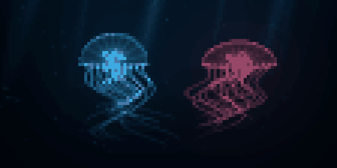

# Jellyfish / 深海水母

English · [中文](README_cn.md)

A quiet terminal aquarium with two luminous jellyfish, pulsing bells, sweeping tentacles,
soft light shafts, plankton and distant fish. It plays automatically without panels
or controls to manage.



## Run

From the repository root:

```bash
cargo run --release --manifest-path examples/jellyfish/Cargo.toml
```

Playback is inline, up to 28 rows high, with width following the terminal. Use True Color
and Unicode half blocks; 112 × 28 is recommended and 80 × 24 works. Press q, Esc or Ctrl+C
to exit. The app does not capture the mouse and caps playback at 30 FPS.

## Verify and export

```bash
cargo test --manifest-path examples/jellyfish/Cargo.toml
cargo run --release --manifest-path examples/jellyfish/Cargo.toml -- --headless
cargo run --release --manifest-path examples/jellyfish/Cargo.toml -- --snapshot /tmp/jellyfish.ppm 8
cargo run --release --manifest-path examples/jellyfish/Cargo.toml -- --frames /tmp/jellyfish-frames
```

`--snapshot FILE.ppm [SECONDS]` defaults to 8 seconds and exports 112 × 56 pixels from
112 × 28 encoded cells. `--frames DIRECTORY` writes 120 PPM frames sampled at 10 FPS
starting at time zero. `--headless` checks 90 time samples and reports drawing/encoding
time without terminal I/O. The preview loops a 12-second excerpt; live playback continues.

[sea.rs](src/sea.rs) generates motion and lighting directly from time, with no external
assets. [main.rs](src/main.rs) supersamples the scene and uses Canvas Half-block encoding
with the render event loop. [export.rs](src/export.rs) reconstructs actual terminal cells.
The animation is an artistic effect rather than a fluid or biological simulation.

[All examples](../README.md)
