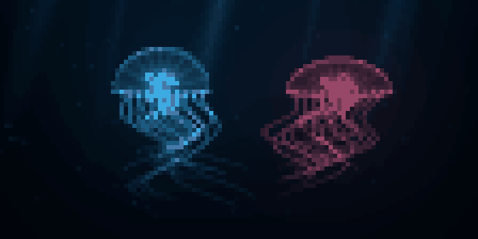

# Jellyfish / 深海水母

[English](README.md) · 中文

安静的终端水族箱：两只发光水母舒展伞体、摆动触须，周围有柔和光束、浮游微粒和远处鱼群。
启动即自动播放，无需操作面板。



## 运行

在仓库根目录执行：

```bash
cargo run --release --manifest-path examples/jellyfish/Cargo.toml
```

使用 inline 模式，最多 28 行，宽度跟随终端。建议支持 True Color 和 Unicode 半块字符，
推荐 112 × 28，80 × 24 也可运行。按 q、Esc 或 Ctrl+C 退出。
不捕获鼠标，播放上限为 30 FPS。

## 验证与导出

```bash
cargo test --manifest-path examples/jellyfish/Cargo.toml
cargo run --release --manifest-path examples/jellyfish/Cargo.toml -- --headless
cargo run --release --manifest-path examples/jellyfish/Cargo.toml -- --snapshot /tmp/jellyfish.ppm 8
cargo run --release --manifest-path examples/jellyfish/Cargo.toml -- --frames /tmp/jellyfish-frames
```

`--snapshot FILE.ppm [SECONDS]` 默认第 8 秒，将 112 × 28 个编码字符格导出为
112 × 56 像素。`--frames DIRECTORY` 从第 0 秒起按 10 FPS 导出 120 张 PPM。
`--headless` 检查 90 个时间点，并报告不包含终端 I/O 的绘制与编码时间。
预览循环播放 12 秒片段，实际运行时持续推进。

[sea.rs](src/sea.rs) 直接根据时间生成运动与光照，无需外部素材。
[main.rs](src/main.rs) 对场景超采样，使用 Canvas Half-block 编码和 render 事件循环。
[export.rs](src/export.rs) 还原实际终端字符格。这是观赏动画，不是流体或生物物理模拟。

[全部示例](../README_cn.md)
