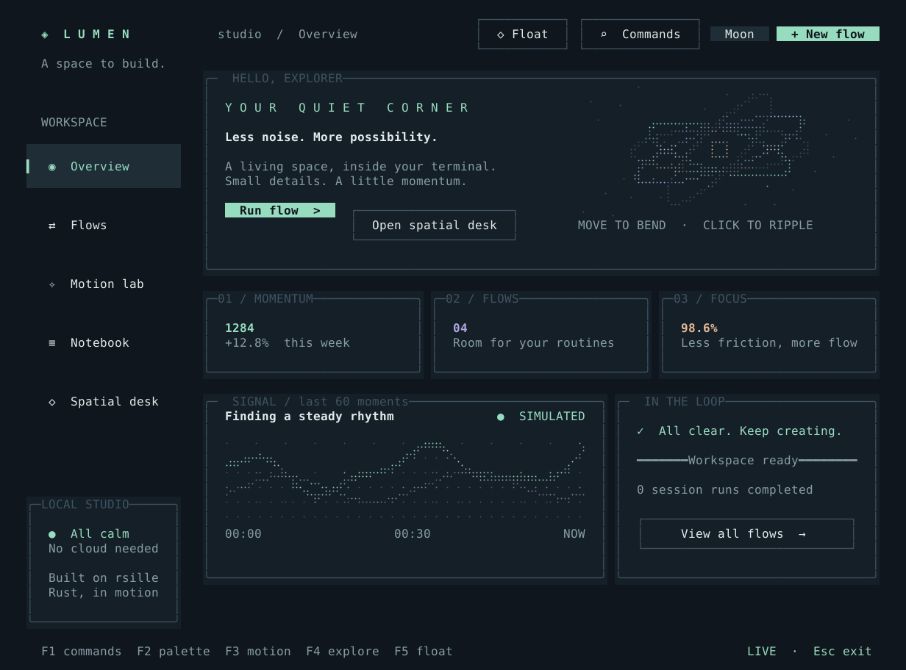
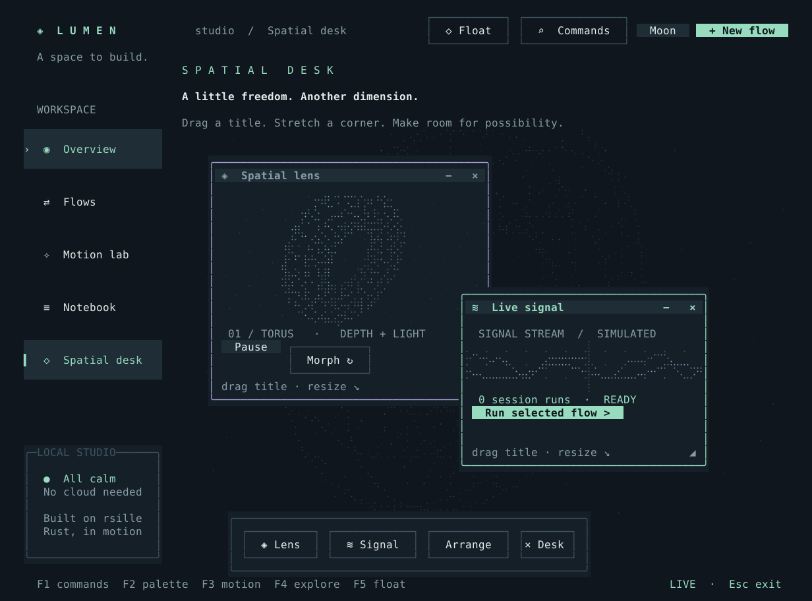

# Lumen

English · [中文](README_cn.md)

An interactive terminal workspace built with rsille: animated charts, flow management,
a Unicode notebook and a floating desktop. All business data is simulated and lives
in memory; notebook saves do not survive exit.




## Run

From the repository root:

```bash
cargo run --release --manifest-path examples/lumen/Cargo.toml
cargo run --release --manifest-path examples/lumen/Cargo.toml -- --page desk
```

Use a True Color terminal with Unicode and mouse support, preferably 120 × 44 or larger.
The default is fullscreen. `--inline` uses the normal screen; `--reduced-motion`
disables decorative motion. No service, account or API key is needed.

## Explore

| Page (`--page`) | Interactions |
| --- | --- |
| `overview` | Animated metrics, live curves, an orbital canvas and pointer ripples |
| `flows` | Search, sort, create and run simulated flows; inspect progress and logs |
| `motion` | Replay reveal, dissolve, sweep and typewriter effects; resize the canvas |
| `notes` | Unicode editing, Markdown preview and a 450 ms debounced in-memory save |
| `desk` | A morphing 3D mesh and floating Spatial lens / Live signal windows |

Drag window titles to move and bottom grips to resize; click to raise a window.
Title controls collapse, minimize to the Dock or close. Dock buttons restore windows;
Arrange resets the layout. Hidden and collapsed windows retain local state, while
closing unmounts their contents. Positions persist across page switches within the session.

| Key | Action |
| --- | --- |
| F1 / Ctrl+K | Search commands and pages |
| F2 | Cycle Moon, Dusk and Paper palettes |
| F3 | Toggle reduced motion |
| F4 / F5 | Next page / toggle floating desktop |
| Tab / Shift+Tab | Move focus |
| Arrows / Shift+arrows on a window title | Move / resize the window |
| Enter / Delete on a window title | Collapse or expand / close |
| Esc / Ctrl+C | Close the current modal first, then exit / exit |

Below 108 columns, the sidebar becomes top navigation. Small viewports scroll.
Modals use Portal input isolation and preserve the background widget tree and focus history.

## Verify and export

```bash
cargo run --manifest-path examples/lumen/Cargo.toml -- --headless
cargo test --manifest-path examples/lumen/Cargo.toml
cargo run --manifest-path examples/lumen/Cargo.toml -- --snapshot /tmp/lumen.svg
cargo run --manifest-path examples/lumen/Cargo.toml -- --snapshot /tmp/lumen-desk.svg --page desk
```

Snapshots export a deterministic 120 × 44 runtime frame. Headless checks replay input
through the same app, covering saves, flow completion, modals, hover and window gestures.

[main.rs](src/main.rs) owns messages and tasks; [ui.rs](src/ui.rs) builds pages;
[art.rs](src/art.rs) draws graphics; [desktop.rs](src/desktop.rs) uses `WindowHost`
and `FloatingWindow`; [verify.rs](src/verify.rs) drives verification and SVG export.

[All examples](../README.md)
