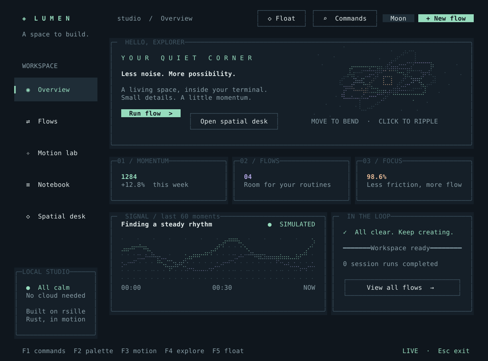
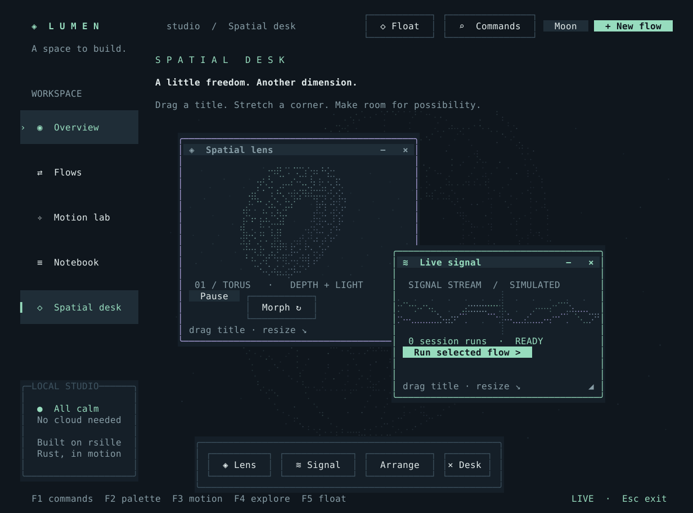

# Lumen

一个用 **rsille 公开 API** 编写的独立 TUI 工作台。柔和的月夜配色、清晰的内容层次、
细腻的交互反馈，让终端也有一点 Web 应用的轻盈感。
鼠标经过卡片时，边框与标题会在 160 ms 内渐亮，移开时柔和恢复；按钮、输入框和侧栏也有悬停反馈。
新增 Spatial desk：可以自由拖动、缩放和叠放的浮窗，以及实时投影的三维网格。





从仓库根目录运行：

```bash
cargo run --release --manifest-path examples/lumen/Cargo.toml
```

建议使用支持 True Color、Unicode 与鼠标的终端，窗口 **120 × 44** 或更大。
无需网络服务、账号、API key 或外部素材。所有业务数据均为演示，保存在当前进程内存中。

```bash
# 在普通终端屏幕运行，保留终端历史
cargo run --release --manifest-path examples/lumen/Cargo.toml -- --inline

# 从动效实验室开始
cargo run --release --manifest-path examples/lumen/Cargo.toml -- --page motion

# 直接体验浮窗与三维画布
cargo run --release --manifest-path examples/lumen/Cargo.toml -- --page desk

# 减少装饰性动画，仍可运行流程与编辑笔记
cargo run --release --manifest-path examples/lumen/Cargo.toml -- --reduced-motion
```

## 五个可以实际操作的页面

| 页面 | 内容与交互 |
| --- | --- |
| Overview | 数字入场、逐项淡入的卡片、持续变化的双曲线、带彗尾的轨道画布、运行状态与通知 |
| Flows | 搜索、名称排序、方向键选择、创建流程的表单弹窗、四阶段运行进度与事件日志 |
| Motion lab | 揭幕、溶解、扫光、打字四种可重播效果；轨道区域平滑扩展；减弱动效开关；浮窗入口 |
| Notebook | Unicode 多行编辑、实时 Markdown 预览、450 ms 防抖、后台保存与过期结果保护 |
| Spatial desk | 三维圆环 / 螺旋网格平滑变形、随深度变化的明暗、指针转动视角、点击脉冲、自由浮窗与共享流程状态 |

鼠标移动到轨道上会轻轻扰动轨道中心，点击会从指针处发出涟漪。
流程在约六秒的模拟时间内完成，切换页面或减弱动效不会中断；再次运行会更新计数和日志。
创建的流程可以马上搜索、选中和运行。Notebook 的保存仅写入内存，退出后不会保留。
Overview 的统计初值和曲线也是演示数据。

## 浮动桌面

从 Overview 的 **Open spatial desk**、侧栏 **Spatial desk** 进入，或在任意页面按 **F5** / 点击顶部 **Float**。
两扇浮窗会跨页面保留位置，底层页面仍可操作：

- **Spatial lens**：实时旋转的三维网格，`Morph` 在圆环与螺旋间平滑变形；`Pause` 暂停自动旋转与波形。
- **Live signal**：带扫描线的双通道模拟波形，显示实际会话流程完成数，按钮可运行当前选中的流程。
- 拖动标题栏移动；拖动底部握柄行缩放；点击窗口置顶；松开时靠近屏幕边缘会吸附。
- 标题右侧 `−` 收起为标题条，`↓` 隐藏到 Dock，`×` 关闭。Dock 的 **Lens / Signal** 可以恢复窗口，**Arrange** 恢复布局，**× Desk** 隐藏整组浮窗。
- Tab 聚焦标题后，用方向键移动、`Shift+方向键` 缩放、`Enter` 收起 / 展开、`Delete` 关闭；聚焦握柄后方向键直接缩放。

窗口位置与尺寸会限制在当前终端范围内；终端缩小时重新约束，失焦、打开弹窗或缩放终端时取消拖拽。
收起的内容退出焦点顺序；命令面板和新建流程弹窗会隔离整个桌面的输入。
F3 减弱动效会冻结网格旋转、扫描和脉冲，形态切换直接完成；拖动和缩放仍可使用。
浮窗和图形全部使用 rsille 的公开 API，在终端内运行。

## 操作

| 按键 | 动作 |
| --- | --- |
| `F1` / `Ctrl+K` | 打开模糊搜索命令面板，搜索页面或操作后回车 |
| `F2` | Moon / Dusk / Paper 三套配色 |
| `F3` | 开关减少动态效果；关闭持续画布运动并跳过入场和布局过渡 |
| `F4` | 切换下一页 |
| `F5` | 在任意页面显示 / 隐藏浮动桌面 |
| `Tab` / `Shift+Tab` | 切换焦点，侧栏与控件提供可见反馈 |
| `Enter` / `Space` | 激活按钮或开关；表格中用方向键移动 |
| `Esc` | 先关闭当前弹窗；在主页面退出 |
| `Ctrl+C` | 退出 |

宽度不足 108 列时侧栏收为顶部标签；较小窗口允许双向滚动。
可以用鼠标滚轮，或 Tab 聚焦页面视口后用方向键 / PageUp / PageDown 滚动。
弹窗只允许内部控件参与焦点与鼠标交互。关闭弹窗后，应用控制的表单值保留；
底层组件重新挂载，光标与局部滚动位置会重新初始化。

## 源码导览

| 文件 | 演示的 rsille 能力 |
| --- | --- |
| [main.rs](src/main.rs) | `App → update → view`、消息驱动状态、定时器、快捷键、后台任务、防抖与结果版本检查 |
| [ui.rs](src/ui.rs) | 语义主题、Grid/Flex/ScrollView、数据表格、编辑器、Markdown、焦点隔离、命令面板、Visual、布局动画和自定义 Widget |
| [art.rs](src/art.rs) | 彩色 Braille Canvas、归一化世界坐标、指针映射、轨道/彗尾/涟漪、三维透视网格、形态插值与扫描波形 |
| [desktop.rs](src/desktop.rs) | Overlay 层级、稳定组件身份、捕获拖拽、自定义窗口装饰、缩放 / 收起 / 恢复、键盘操作与布局过渡 |
| [verify.rs](src/verify.rs) | 同一应用的无 TTY 输入回放、手动时钟/执行器、真实 frame 断言和 SVG 导出 |

悬停使用 rsille 的通用命中检测与组件 API，没有直接发送 ANSI 绘制序列。卡片通过
`.hover_border_style(Style::default().fg(p.mint))` 开启高亮，自定义侧栏通过
`RenderCtx::is_hovered()` / `AnimationCtx::is_hovered()` 驱动过渡；减少动态效果时即时切换。
唯一的直接辅助依赖
`crossterm` 用于读取启动窗口大小及将公开 frame 中的颜色/字重导出成 SVG。

## 验证与导出

```bash
cargo run --manifest-path examples/lumen/Cargo.toml -- --headless
cargo test --manifest-path examples/lumen/Cargo.toml
cargo clippy --manifest-path examples/lumen/Cargo.toml --all-targets -- -D warnings
cargo fmt --manifest-path examples/lumen/Cargo.toml -- --check

# 无需 TTY，导出实际运行器渲染的 120 × 44 帧
cargo run --manifest-path examples/lumen/Cargo.toml -- --snapshot /tmp/lumen.svg
cargo run --manifest-path examples/lumen/Cargo.toml -- --snapshot /tmp/lumen-motion.svg --page motion
cargo run --manifest-path examples/lumen/Cargo.toml -- --snapshot /tmp/lumen-desk.svg --page desk
```

交互验证覆盖鼠标悬停时卡片边框变化、移开恢复、焦点保持、弹窗背景悬停隔离、鼠标点击画布、键盘导航、切页期间流程完成、通知过期保护、表格搜索与排序、
Unicode 流程创建、弹窗焦点与背景点击隔离、Ctrl+K 模糊搜索、Unicode 编辑、重复编辑重置防抖、
后台任务完成及过期结果、动效选择与布局切换，三套配色下五个页面在五种窗口尺寸的渲染；以及浮窗拖拽即时跟随、越界捕获与释放、缩放、置顶与遮挡命中、收起后的焦点顺序、关闭恢复、跨页共享状态、减弱动效和小终端边界。
SVG 中的 Braille 被导出为圆点，查看预览不依赖本机是否安装 Braille 字体。

浮动桌面使用框架的 `WindowHost`、`FloatingWindow` 和通用 cell 手势协议。隐藏和收起
会保留内容局部状态；关闭会卸载窗口，Dock 可再次创建。流程表使用 DataTable 的受控
`active_row` 属性，弹窗和命令面板使用 Portal 模态层，保留背景组件与焦点历史。
