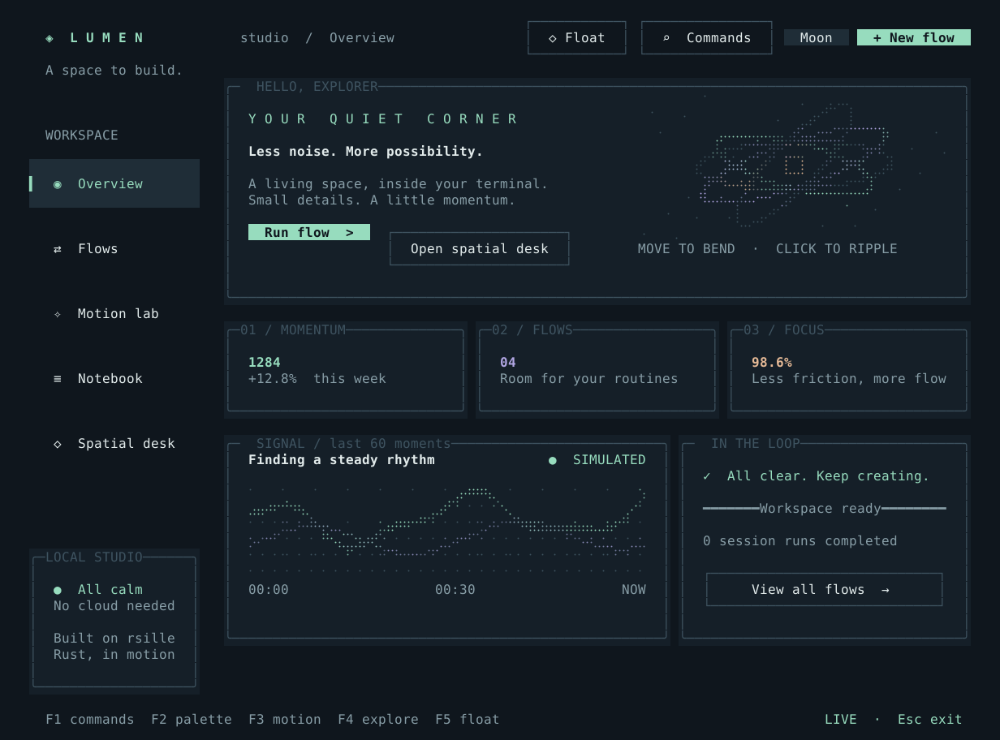
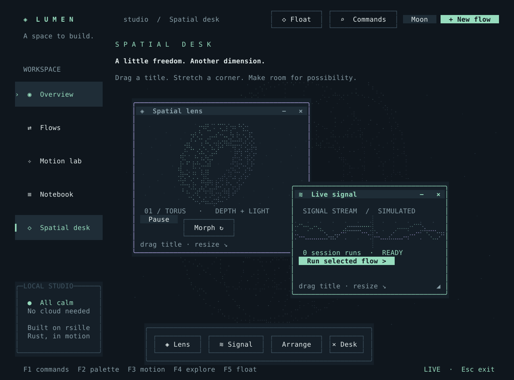

# Lumen

[English](README.md) · 中文

使用 rsille 构建的终端工作台，包含动态图表、流程管理、Unicode 笔记和浮动桌面。
业务数据均为模拟数据，仅保存在内存中；笔记保存不会跨退出保留。




## 运行

在仓库根目录执行：

```bash
cargo run --release --manifest-path examples/lumen/Cargo.toml
cargo run --release --manifest-path examples/lumen/Cargo.toml -- --page desk
```

建议使用支持 True Color、Unicode 和鼠标的终端，窗口至少 120 × 44。
默认全屏；`--inline` 使用普通屏幕，`--reduced-motion` 关闭装饰性动态效果。
无需服务、账号或 API key。

## 体验内容

| 页面（`--page`） | 交互 |
| --- | --- |
| `overview` | 数字入场、实时曲线、轨道画布与指针涟漪 |
| `flows` | 搜索、排序、创建和运行模拟流程，查看进度与日志 |
| `motion` | 重播揭幕、溶解、扫光和打字效果，调整画布大小 |
| `notes` | Unicode 编辑、Markdown 预览、450 ms 防抖后保存到内存 |
| `desk` | 三维网格变形，以及 Spatial lens / Live signal 浮窗 |

拖动标题栏移动窗口，拖动底部握柄缩放，点击窗口置顶。标题按钮可收起、隐藏到 Dock 或关闭，
Dock 按钮可恢复窗口，Arrange 重置布局。隐藏和收起保留局部状态，关闭会卸载内容。
本次会话内切换页面时保留窗口位置。

| 按键 | 操作 |
| --- | --- |
| F1 / Ctrl+K | 搜索命令和页面 |
| F2 | 切换 Moon、Dusk、Paper 配色 |
| F3 | 开关减少动态效果 |
| F4 / F5 | 下一页 / 显示或隐藏浮动桌面 |
| Tab / Shift+Tab | 切换焦点 |
| 标题栏上的方向键 / Shift+方向键 | 移动 / 缩放窗口 |
| 标题栏上的 Enter / Delete | 收起或展开 / 关闭 |
| Esc / Ctrl+C | 先关闭当前弹窗，再退出 / 退出 |

不足 108 列时侧栏改为顶部导航，小窗口可滚动。弹窗通过 Portal 隔离输入，
保留背景组件树和焦点历史。

## 验证与导出

```bash
cargo run --manifest-path examples/lumen/Cargo.toml -- --headless
cargo test --manifest-path examples/lumen/Cargo.toml
cargo run --manifest-path examples/lumen/Cargo.toml -- --snapshot /tmp/lumen.svg
cargo run --manifest-path examples/lumen/Cargo.toml -- --snapshot /tmp/lumen-desk.svg --page desk
```

快照导出确定性的 120 × 44 运行时画面。无终端检查通过同一应用回放输入，覆盖保存、流程完成、
弹窗、悬停和窗口手势。

[main.rs](src/main.rs) 管理消息和任务，[ui.rs](src/ui.rs) 构建页面，
[art.rs](src/art.rs) 绘图，[desktop.rs](src/desktop.rs) 使用 `WindowHost` 和
`FloatingWindow`，[verify.rs](src/verify.rs) 负责验证和 SVG 导出。

[全部示例](../README_cn.md)
