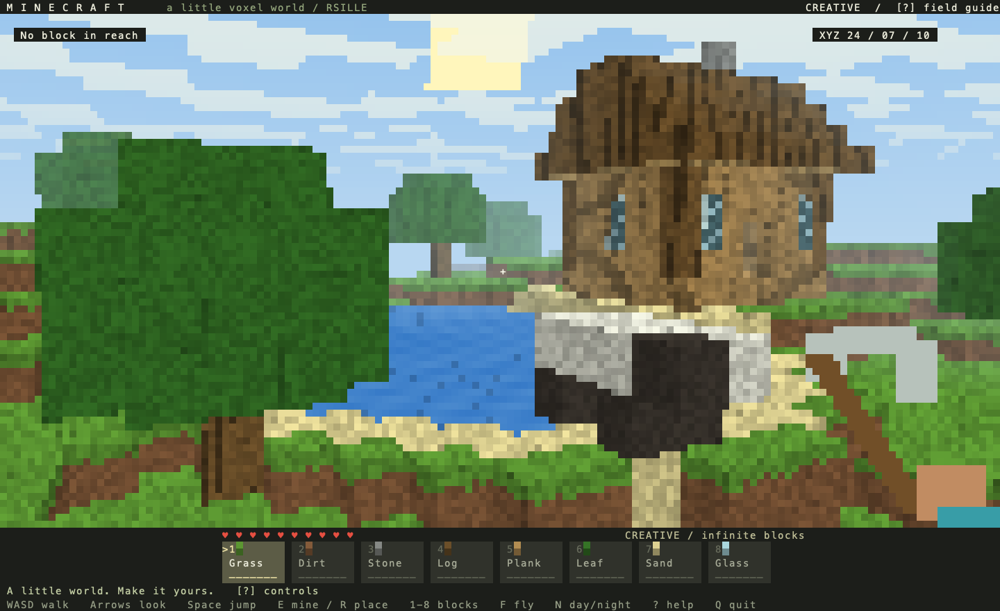

# Minecraft

English · [中文](README_cn.md)

A first-person terminal voxel sandbox: explore grassland, oak trees, a lake, a cabin and
a block sheep, then mine and build with an eight-slot hotbar.



## Run

From the repository root:

```bash
cargo run --release --manifest-path examples/minecraft/Cargo.toml
```

Use a True Color terminal with Unicode half-block glyphs. Recommended size is 120 × 40
or 144 × 44; 80 × 24 is also playable. The app runs fullscreen and restores the terminal
on exit.

## Controls

| Input | Action |
| --- | --- |
| w, a, s, d / arrows | Move / turn and look up or down |
| Space / f / c | Jump or ascend in flight / toggle flight / descend in flight |
| e / left click | Mine the targeted block |
| r / right click | Place a block on the targeted face |
| 1–8 / wheel / hotbar click | Choose grass, dirt, stone, oak, planks, leaves, sand or glass |
| Middle-button drag | Turn the camera |
| n / Home | Toggle day/night / return to spawn in flight mode |
| p / Esc / ? | Pause or resume / pause or resume / help |
| q / Ctrl+C | Exit |

Reach is six blocks. Walking includes collision, gravity, jumping and one-block steps.
Blocks are unlimited, HUD hearts are decorative, and the sheep is a static block model.
The seeded world is 64 × 32 × 64. Edits last only for the session; there is no save,
crafting or combat system.

## Held-key input

The app requests enhanced keyboard reporting. When key releases are available, movement
and camera keys maintain independent held states and use elapsed frame time, allowing
simultaneous walking and turning. Diagonal movement is normalized. Menus, focus loss,
flight changes and returning to spawn clear motion; release and press keys again to resume.

Legacy terminals use bounded smoothing of individual key events. This fallback depends
on keyboard repeat timing and cannot guarantee independent holds or precise stopping
on release. Startup and help show the active mode. Real terminal, SSH and multiplexer
combinations may expose different input capabilities.

## Verify and export

```bash
cargo test --manifest-path examples/minecraft/Cargo.toml
cargo run --release --manifest-path examples/minecraft/Cargo.toml -- --headless
cargo run --release --manifest-path examples/minecraft/Cargo.toml -- --snapshot /tmp/minecraft.svg
cargo run --release --manifest-path examples/minecraft/Cargo.toml -- --snapshot /tmp/minecraft-night.svg --night
cargo run --release --manifest-path examples/minecraft/Cargo.toml -- --benchmark
```

For interactive input diagnostics:

```bash
cargo run --release --manifest-path examples/minecraft/Cargo.toml -- --input-log /tmp/minecraft-input.log
python3 scripts/check-terminal-input.py
```

The log records negotiated capabilities and raw input. The Python script simulates
terminal protocols in a Unix PTY; it does not replace testing physical key combinations.
Benchmarks exclude terminal I/O.

[world.rs](src/world.rs) handles terrain and collision; [scene.rs](src/scene.rs) implements
CPU voxel ray traversal and half-block drawing; [input.rs](src/input.rs) tracks keys;
[main.rs](src/main.rs) connects the app; [verify.rs](src/verify.rs) tests and exports frames.

[All examples](../README.md)
