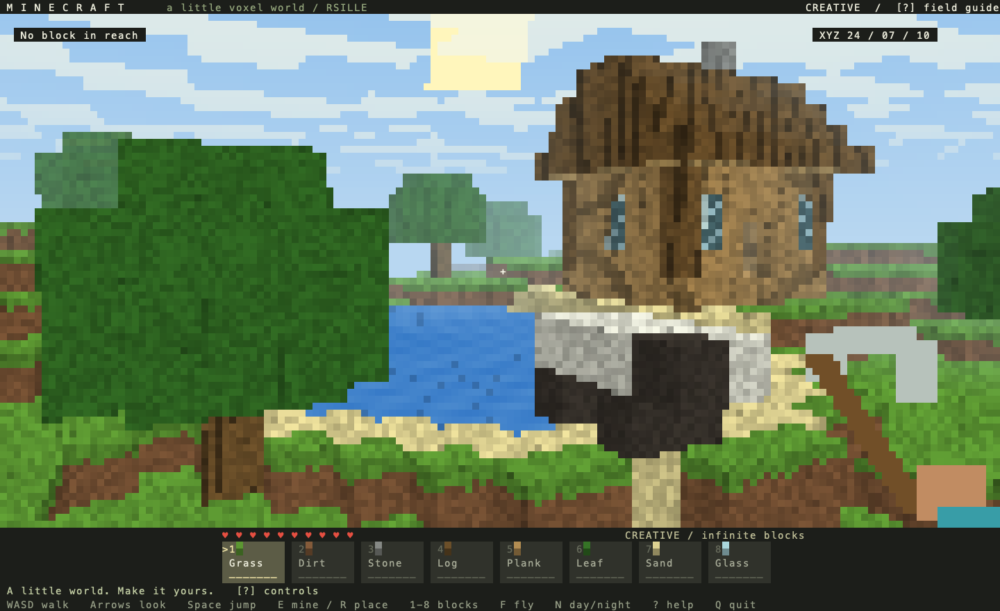

# Minecraft / 一个小小的方块世界

用当前 rsille 公开接口写的第一人称终端沙盒。打开就能看到像素草地、橡树、湖泊、
沙岸、小木屋和一只方块羊；拿着镐，在准星指向的位置挖掘和搭建。

```bash
# 从仓库根目录运行，推荐 release
cargo run --release --manifest-path examples/minecraft/Cargo.toml
```

推荐支持 **True Color** 和 Unicode `▀` 的终端、等宽字体，以及 **120 × 40**
或 **144 × 44** 的窗口。**80 × 24** 也可玩，窗口大小随时可调。
默认全屏，退出后恢复终端。



## 操作

| 按键 / 鼠标 | 功能 |
| --- | --- |
| `W A S D` | 前后左右平滑走动，支持长按重复 |
| 方向键 | 平滑转头、抬头、低头 |
| `Space` | 跳跃；飞行时上升 |
| `F` / `C` | 开关飞行 / 飞行时下降 |
| `E` / 鼠标左键 | 挖掉准星指向的方块 |
| `R` / 鼠标右键 | 在准星指向的方块表面放置方块 |
| `1`–`8` / 滚轮 / 点击快捷栏 | 选择草地、泥土、石头、橡木、木板、树叶、沙子、玻璃 |
| 鼠标中键拖动 | 转动视角；也可以全程用方向键 |
| `N` | 切换白天 / 星空夜晚 |
| `Home` | 回到出生点并开启飞行，保留本次搭建 |
| `P` / `Esc` | 暂停 / 继续 |
| `?` | 打开 / 关闭操作手册 |
| `Q` / `Ctrl+C` | 退出 |

方块触及距离为 **6 格**，瞄准时会显示方块名称、距离和边缘高亮。
走路有碰撞、重力和跳跃，可自动跨上一格高的台阶。
创造模式提供无限方块，不消耗快捷栏物品；底部爱心是经典 HUD 的装饰。
羊是可挖掘的静态方块造型。世界为固定种子的 **64 × 32 × 64** 有限地图，
本次修改在退出时结束；没有合成、战斗或存档。

键盘移动和转向由 demo 按每帧时间平滑推进，单次输入约 150 ms 内完成 94%，
重复事件之间也会继续运动。待执行动作有上限，暂停、手册、切换飞行或回到出生点会清空，
鼠标拖动视角保持直接响应。当前仍使用传统终端按键重复，长按开始前的系统延迟与
多键同时按住的限制仍存在；本例没有启用增强键盘协议或修改 rsille 框架。

## 实现

- rsille 的 `App`、`on_frame`、消息更新和 `Widget` 管理应用与输入。
- 自定义组件通过 `Chunk` / `Style` 输出真彩色 `▀`：每个字符有上下两个像素，
  保留方块轮廓与像素纹理，不需要图像素材、图形窗口或游戏引擎。
- 示例实现 CPU 三维 DDA 方块遍历、透视相机、面光照、距离雾、程序化材质、
  方块边缘高亮、云层、水面和手持镐动画。天空随昼夜切换。
- 地图数据通过 `Arc` 共享，编辑时才复制；界面按状态重建时不会复制整个地图。
- 手册和暂停菜单使用原生 `dialog` / `overlay` / `button`，并限制弹窗内的焦点。

| 源码 | 用途 |
| --- | --- |
| `src/main.rs` | 应用、键盘映射、暂停与手册 |
| `src/world.rs` | 地形、建筑、方块、射线拾取、碰撞、跳跃和编辑 |
| `src/scene.rs` | 三维画面、像素材质、HUD、鼠标与快捷栏 |
| `src/verify.rs` | 真实运行时验证、SVG 帧导出和 CPU 帧耗时 |

## 验证与导出

```bash
cargo test --manifest-path examples/minecraft/Cargo.toml
cargo clippy --manifest-path examples/minecraft/Cargo.toml --all-targets -- -D warnings
cargo run --release --manifest-path examples/minecraft/Cargo.toml -- --headless
cargo run --release --manifest-path examples/minecraft/Cargo.toml -- --benchmark
cargo run --release --manifest-path examples/minecraft/Cargo.toml -- --snapshot /tmp/minecraft.svg
cargo run --release --manifest-path examples/minecraft/Cargo.toml -- --snapshot /tmp/minecraft-night.svg --night
```

测试覆盖射线命中面与距离、挖掘放置、基岩保护、玩家碰撞、跳跃落地、暂停冻结、
真实键鼠输入、快捷栏、弹窗焦点、飞行、昼夜、回到出生点、极小窗口与退出，
以及不同帧率下的输入平滑、重复事件之间的连续运动、积压上限和暂停后清空动作。
`--snapshot` 导出实际 rsille Buffer；`--benchmark` 测量 144 × 44 下的 CPU 更新与绘制，
不含终端 I/O，实际显示帧率还取决于终端处理真彩色输出的速度。
