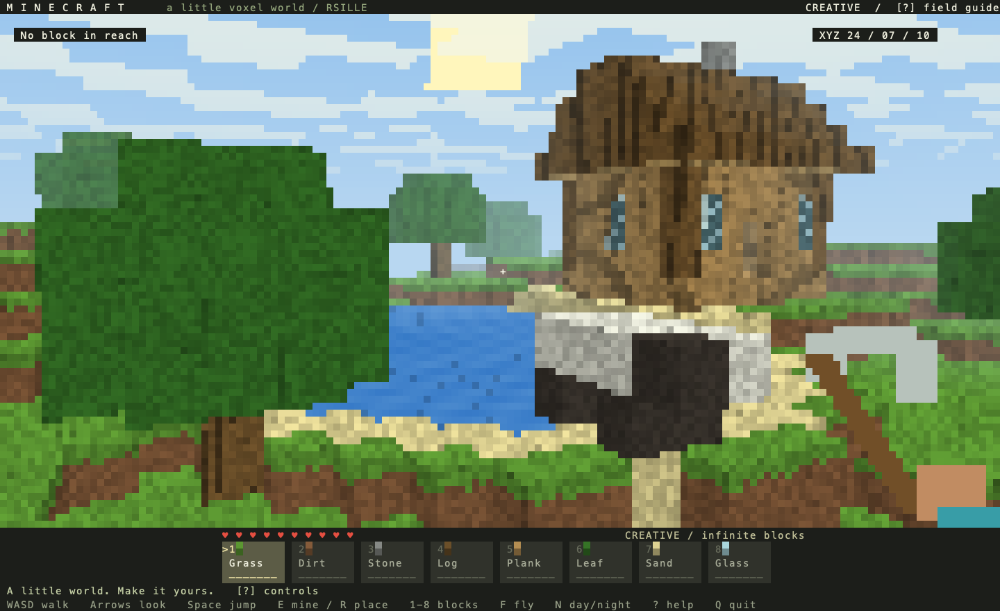

# Minecraft

[English](README.md) · 中文

第一人称终端方块沙盒：探索草地、橡树、湖泊、小木屋和方块羊，通过八格快捷栏挖掘和搭建。



## 运行

在仓库根目录执行：

```bash
cargo run --release --manifest-path examples/minecraft/Cargo.toml
```

使用支持 True Color 和 Unicode 半块字符的终端。推荐 120 × 40 或 144 × 44，
80 × 24 也可游玩。默认全屏，退出后恢复终端。

## 操作

| 输入 | 操作 |
| --- | --- |
| w、a、s、d / 方向键 | 移动 / 转头、抬头或低头 |
| 空格 / f / c | 跳跃或飞行上升 / 开关飞行 / 飞行下降 |
| e / 左键 | 挖掘准星指向的方块 |
| r / 右键 | 在目标表面放置方块 |
| 1–8 / 滚轮 / 点击快捷栏 | 选择草地、泥土、石头、橡木、木板、树叶、沙子或玻璃 |
| 中键拖动 | 转动相机 |
| n / Home | 切换昼夜 / 回到出生点并开启飞行 |
| p / Esc / ? | 暂停或继续 / 暂停或继续 / 帮助 |
| q / Ctrl+C | 退出 |

触及距离为六格。行走包含碰撞、重力、跳跃和一格台阶跨越。方块无限，HUD 爱心仅为装饰，
羊是静态方块造型。固定种子的地图大小为 64 × 32 × 64，修改仅在本次会话中保留，
不提供存档、合成或战斗系统。

## 按住键输入

应用会请求增强键盘上报。支持松键事件时，移动和转向键独立维护按住状态，按帧经过的时间
推进运动，可以边走边转头，斜向移动不会加速。菜单、失焦、切换飞行和回到出生点会清空动作；
恢复后需松开并重新按下相关键。

传统终端对单次按键事件进行有限平滑。这条兼容路径受系统重复延迟和频率影响，无法保证
独立多键按住或准确松手停止。启动提示和帮助会显示当前输入模式；实际终端、SSH 和
复用器组合可能提供不同的输入能力。

## 验证与导出

```bash
cargo test --manifest-path examples/minecraft/Cargo.toml
cargo run --release --manifest-path examples/minecraft/Cargo.toml -- --headless
cargo run --release --manifest-path examples/minecraft/Cargo.toml -- --snapshot /tmp/minecraft.svg
cargo run --release --manifest-path examples/minecraft/Cargo.toml -- --snapshot /tmp/minecraft-night.svg --night
cargo run --release --manifest-path examples/minecraft/Cargo.toml -- --benchmark
```

交互输入诊断：

```bash
cargo run --release --manifest-path examples/minecraft/Cargo.toml -- --input-log /tmp/minecraft-input.log
python3 scripts/check-terminal-input.py
```

日志记录协商后的能力和原始输入。Python 脚本在 Unix PTY 中模拟终端协议，不能替代真实按键
组合测试。性能测量不包含终端 I/O。

[world.rs](src/world.rs) 处理地形和碰撞，[scene.rs](src/scene.rs) 实现 CPU 方块射线遍历
和半块绘图，[input.rs](src/input.rs) 跟踪按键，[main.rs](src/main.rs) 连接应用，
[verify.rs](src/verify.rs) 验证并导出画面。

[全部示例](../README_cn.md)
