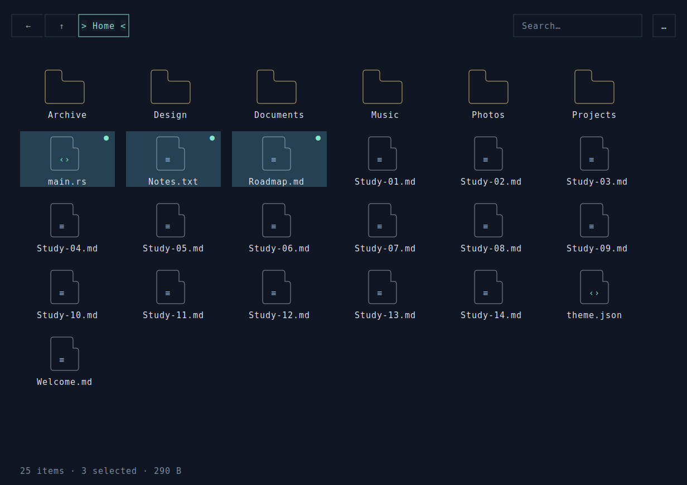
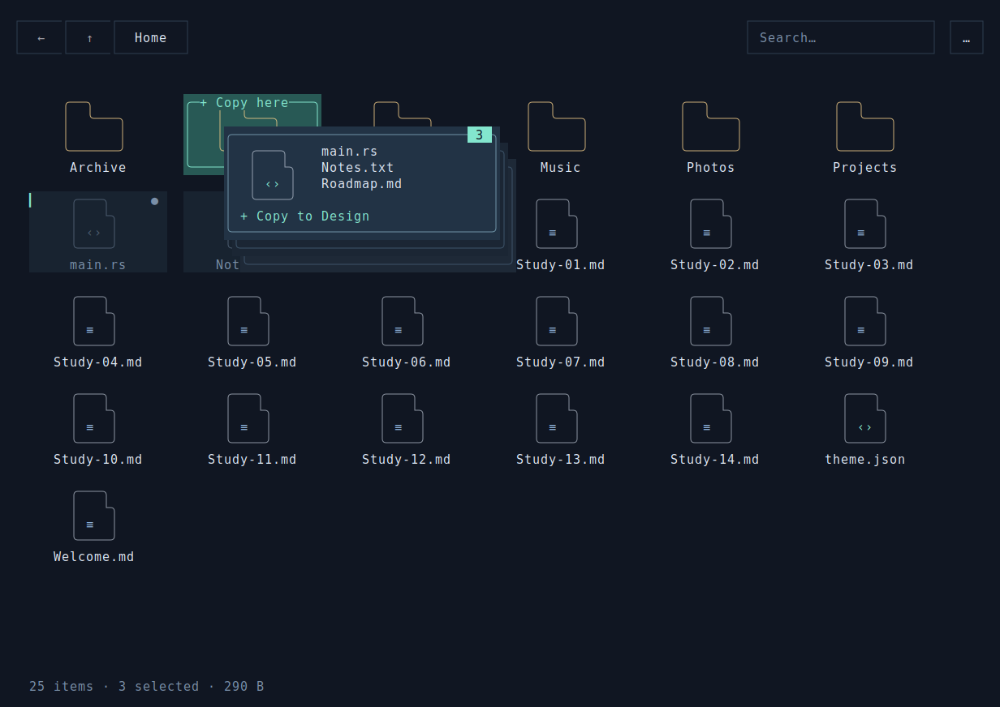

# Orbit Files

English · [中文](README_cn.md)

A file manager built with rsille, with marquee selection, multi-file drag and drop,
copy/cut/paste, previews, context menus and undo. It reads and changes local files;
background tasks perform copying and batch moves.




## Run

From the repository root:

```bash
cargo run --release --manifest-path examples/orbit-files/Cargo.toml
cargo run --release --manifest-path examples/orbit-files/Cargo.toml -- --path ~/Downloads
```

By default, the app creates a disposable demo directory, confines navigation to it and
removes it on clean exit. **`--path DIR` operates on real files.** Full file-operation
support requires Linux. Use a True Color terminal with Unicode and mouse support,
preferably 100 × 30 or larger. `--inline` uses the normal terminal screen.

## Select, navigate and organize

Click to select; Ctrl-click toggles items and Shift-click selects a range. Drag empty
space to draw a marquee; Ctrl or Shift adds to the selection. Drag selected files onto
a folder to move the whole group; hold Ctrl when releasing to copy. A floating preview
shows the selected group and destination. Esc, focus loss or resize cancels the drag.

Double-click a folder to enter it, or a file to preview it. Preview shows a symlink's
target or up to the first 4 KiB of text; binary files show a notice. Right-click an item
or empty space for actions. The top “…” menu also contains sort, grid/list and hidden-file
options. Search filters the current directory only and is case-insensitive.

File shortcuts apply while the file pane has focus; editors keep their own editing
shortcuts. The clipboard is an application-local list of paths.

| Key | Action |
| --- | --- |
| Arrows / Home / End / PageUp / PageDown | Navigate and scroll |
| Shift+arrows / Ctrl+arrows / Space | Extend range / move without changing selection / toggle current item |
| Ctrl+A | Select all matching entries, including off-screen entries |
| Ctrl+C / Ctrl+X / Ctrl+V | Copy / cut / paste |
| Ctrl+Z / Ctrl+N | Undo / new folder |
| Delete / F2 / F5 | Confirm trash / rename / refresh |
| Enter / Backspace / Alt+left / Alt+right | Open / parent / back / forward |
| Ctrl+H / Ctrl+F / Ctrl+L | Hidden files / search / address |
| F1 / Tab / Shift+Tab | Help / next focus / previous focus |
| Esc / Ctrl+Q | Close modal, cancel drag or clear selection / confirm exit |

## Filesystem behavior

- Copying directories is recursive; name conflicts produce `name (copy 1).ext` variants.
- Moves, renames and undo use Linux `RENAME_NOREPLACE` and fail if the destination
  exists. Cross-filesystem moves fail; use copying instead.
- Delete moves items into `.orbit-trash-<unique-id>/` inside their original parent.
  This is app-managed storage, not the system trash. Real-directory mode leaves it
  on disk after exit; the app has no permanent-delete action.
- Undo covers successful moves, renames and trash operations in the current session.
  Copies and new folders are not undoable. After restarting, recover trashed files
  manually from the hidden directories.
- Unix symlinks are copied as links; special files are skipped. Partial batch failures
  retain successful operations and report errors. F5 refreshes external changes.

## Verify and export

```bash
cargo run --manifest-path examples/orbit-files/Cargo.toml -- --headless
cargo test --manifest-path examples/orbit-files/Cargo.toml
cargo run --manifest-path examples/orbit-files/Cargo.toml -- --snapshot /tmp/orbit-files.svg
cargo run --manifest-path examples/orbit-files/Cargo.toml -- --snapshot-drag /tmp/orbit-drag.svg
```

Verification uses temporary files and the actual runtime. Snapshots export 120 × 42
frames; `--snapshot-drag` requires demo mode and captures a drag without dropping it.

[main.rs](src/main.rs) manages state and tasks; [board.rs](src/board.rs) handles the
file pane; [files.rs](src/files.rs) implements disk operations; [ui.rs](src/ui.rs)
builds navigation and Portal modals; [drag.rs](src/drag.rs) and [icons.rs](src/icons.rs)
render drag feedback and icons; [verify.rs](src/verify.rs) checks interactions.

[All examples](../README.md)
