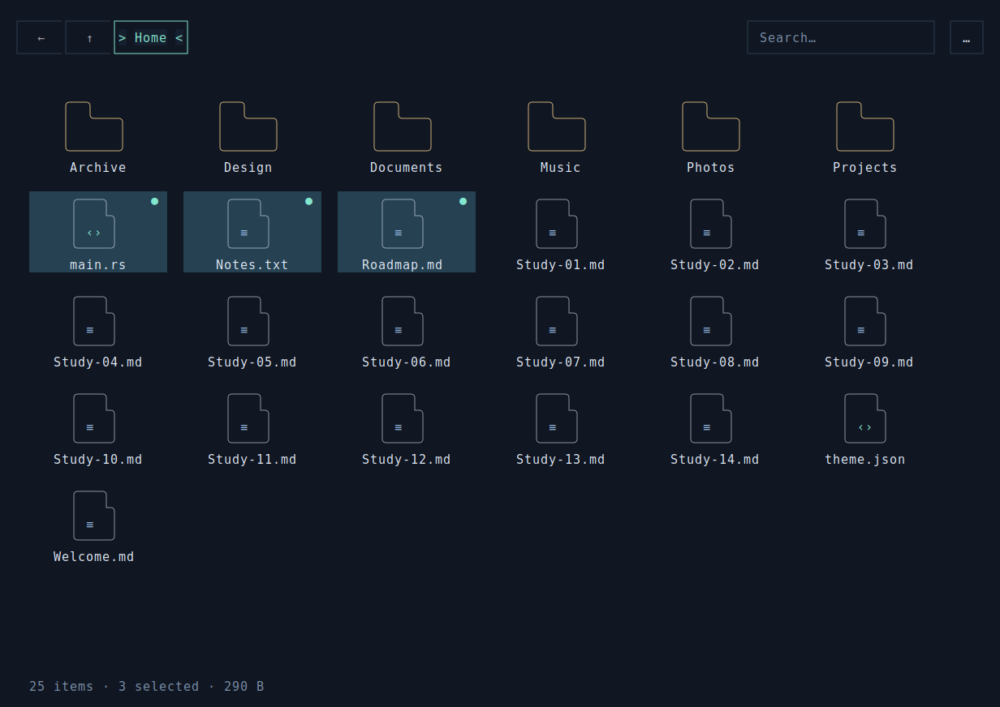
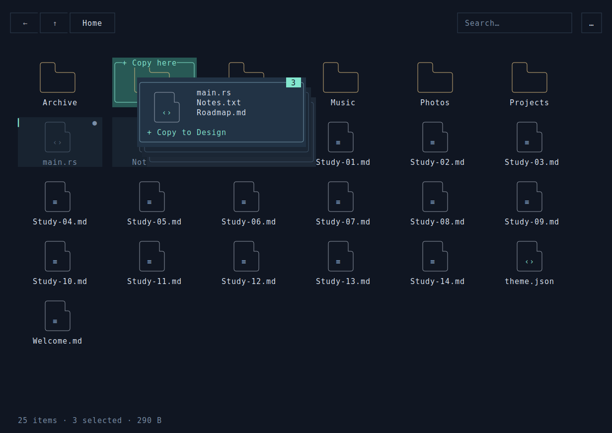

# Orbit Files

用 **rsille 公开 API** 编写的简洁文件管理器：一行导航与搜索、大面积文件区、一行状态栏。
框选和拖放直接在文件区操作，其他功能通过右键菜单或顶部“…”打开，文件预览按需弹出。
实际读取和操作本地文件，复制与批量移动通过 rsille 后台任务执行。
文件图标使用轻量的 Unicode 圆角线条绘制：文件夹页签、图片山形与文件类型标记，
网格和拖动预览共用同一套配色，列表使用对应的紧凑符号，无需安装额外图标字体。





从仓库根目录运行：

```bash
cargo run --release --manifest-path examples/orbit-files/Cargo.toml
```

默认创建一次性的演示目录，包含示例文件和子目录，可练习框选、拖动、复制与删除。
导航限制在这个目录内，正常退出时清理。使用支持 True Color、Unicode 和鼠标的终端；
建议 **100 × 30** 或更大；宽度小于 78 列时收起搜索框，可用 Ctrl+F 搜索。
窄窗口仍可通过键盘执行文件操作、搜索和打开地址。

```bash
# 打开真实目录；复制、移动、重命名和删除会实际改变磁盘上的文件
cargo run --release --manifest-path examples/orbit-files/Cargo.toml -- --path ~/Downloads

# 在普通终端屏幕运行
cargo run --release --manifest-path examples/orbit-files/Cargo.toml -- --inline
```

## 鼠标操作

- 点击文件选择，`Ctrl+点击` 增减选择，`Shift+点击` 选择连续范围；点击组内的一个文件并松手可收拢选择。
- **在空白处按住左键拖动**，显示无边框的淡蓝绿色蒙版并批量选中文件；按 Ctrl 或 Shift 框选可追加到已有选择。
- **拖动选中的文件到文件区里的文件夹上**，整组移动；松手时按住 Ctrl，整组复制。
- 拖动时鼠标旁显示浮动文件预览：多文件堆叠、数量徽标、文件名，以及当前复制/移动目标。原位置的文件变淡；有效目标有高亮边框，无效位置显示不可放置提示。
- 悬浮预览不拦截鼠标，越过文件区仍跟随指针，靠近窗口边缘自动换边；松手、Esc、失焦或窗口缩放时立即消失。拖过文件区上下边缘并继续移动指针，可以滚动并扩展选择。
- 双击文件夹进入，双击文件或按 Enter 打开预览弹窗。预览支持符号链接目标以及文件开头最多 4 KiB 的文本；二进制文件显示提示，Esc 关闭。
- 右键文件打开操作菜单，保留已选中的整组；右键空白打开目录操作菜单。
- 滚轮滚动文件区；顶部只保留后退、上级、地址、搜索和“…”菜单。前进、排序、网格/列表切换、隐藏文件与帮助均在菜单内。
- Esc 取消正在进行的框选并恢复此前选择；失焦、窗口缩放、弹窗打开、目录内容变化也会取消指针捕获。

## 键盘操作

文件选择和剪贴板快捷键在文件区获得焦点时使用，点击文件区或用 Tab 切换焦点即可。
输入框保留自己的文本编辑行为。剪贴板是应用内的路径列表。

| 按键 | 操作 |
| --- | --- |
| 方向键 / Home / End / PageUp / PageDown | 移动当前文件并滚动到可见位置 |
| Shift + 方向键 | 连续范围选择 |
| Ctrl + 方向键 / Space | 移动光标而保留选择 / 切换当前文件的选择 |
| Ctrl+A | 选择当前目录里所有符合搜索与隐藏设置的条目，包括屏幕外条目 |
| Ctrl+C / Ctrl+X / Ctrl+V | 复制 / 剪切 / 在当前目录粘贴 |
| Ctrl+Z | 撤销上一次移动、重命名或移入暂存回收目录；可连续撤销 |
| Ctrl+N | 新建文件夹 |
| Delete | 确认后移入暂存回收目录 |
| Enter / Backspace | 打开当前文件 / 返回上级目录 |
| Alt+左 / Alt+右 | 后退 / 前进 |
| Ctrl+H | 显示或隐藏点文件 |
| Ctrl+F / Ctrl+L | 搜索当前目录 / 输入目录地址（也接受相对路径） |
| F1 / F2 / F5 | 帮助 / 重命名 / 刷新 |
| Tab / Shift+Tab | 切换焦点，弹窗内隔离输入 |
| Esc | 关闭弹窗、取消拖动或清空选择 |
| Ctrl+Q | 确认退出；正在操作文件时等待操作完成 |

菜单中的排序项依次切换名称、大小、修改时间，每完成一轮切换升降序，文件夹始终排在前面。
搜索仅过滤当前目录，大小写不敏感；不会递归检索子目录。

## 文件操作约定

- **复制重名**自动生成 `name (copy 1).ext` 等副本名，递归复制目录。
- **移动、重命名、撤销**使用 Linux 的原子 `RENAME_NOREPLACE`，目标已存在时报告失败，保留两边文件。
  跨文件系统移动直接报告错误，可改用复制；本示例的完整文件操作需要 **Linux**。
- **删除**移到原父目录下的 `.orbit-trash-<唯一标识>/原文件名`，这是本应用的暂存目录，
  不接入操作系统回收站。真实目录模式退出后仍保留，应用内不提供永久删除。
- 撤销记录保存在当前会话内；重启后可到上述隐藏暂存目录手动恢复文件。
  复制与新建目录不加入撤销历史，界面中的 Undo 针对移动、重命名和暂存删除。
- 后台任务按条目显示进度，部分失败时保留已完成结果，只把成功的移动加入撤销记录。
  自身目录及其子目录不能成为该目录的复制/移动目标。
- Unix 符号链接按链接本身复制，不递归跟随；设备、套接字和管道等特殊文件不参与复制或预览。
- 状态与剪贴板不跨进程保存；F5 手动刷新目录。修改外部目录前请确认启动参数中的路径。

## 验证与预览导出

```bash
cargo run --manifest-path examples/orbit-files/Cargo.toml -- --headless
cargo test --manifest-path examples/orbit-files/Cargo.toml
cargo clippy --manifest-path examples/orbit-files/Cargo.toml --all-targets -- -D warnings
cargo fmt --manifest-path examples/orbit-files/Cargo.toml -- --check

# 从实际运行器导出 SVG，无需 TTY
cargo run --manifest-path examples/orbit-files/Cargo.toml -- --snapshot /tmp/orbit-files.svg

# 导出实际捕获的多文件拖动（演示目录，不执行松手操作）
cargo run --manifest-path examples/orbit-files/Cargo.toml -- --snapshot-drag /tmp/orbit-drag.svg
```

验证使用真实的 `App → update → view`、手动执行器和临时文件系统，回放鼠标与键盘事件。
覆盖框选、越界捕获及取消、快速连续输入、Ctrl/Shift 多选、双击、右键菜单、整组拖动移动/复制、
冲突保护、剪贴板、递归复制、符号链接、Unicode 创建与重命名、删除恢复、弹窗输入隔离、
搜索、隐藏文件、滚动、刷新期间的拖拽取消和多种窗口尺寸。拖动反馈还验证了浮层跟随、原文件淡化、
复制/移动标识、无效目标、Ctrl 拾取多选、释放时固定操作文件集，以及取消后浮层清理。
测试不读写用户自己的目录。

| 文件 | 内容 |
| --- | --- |
| [main.rs](src/main.rs) | 状态、目录导航、消息更新、后台任务、剪贴板、撤销与启动参数 |
| [board.rs](src/board.rs) | 自定义文件网格/列表，虚拟滚动、框选、捕获拖拽与键盘多选 |
| [drag.rs](src/drag.rs) | 不拦截输入的悬浮拖动层、堆叠文件卡片、数量徽标、放置状态与边缘换边 |
| [icons.rs](src/icons.rs) | 网格、列表与拖动预览共用的文件类型图标、配色与淡化状态 |
| [ui.rs](src/ui.rs) | 主题、精简导航、Grid/Flex、原生按钮/输入框/菜单、Portal 弹窗与按需预览 |
| [files.rs](src/files.rs) | 文件扫描、递归复制、无覆盖移动、暂存删除与演示目录 |
| [verify.rs](src/verify.rs) | 无 TTY 的输入回放、磁盘断言与实际帧的 SVG 导出 |
