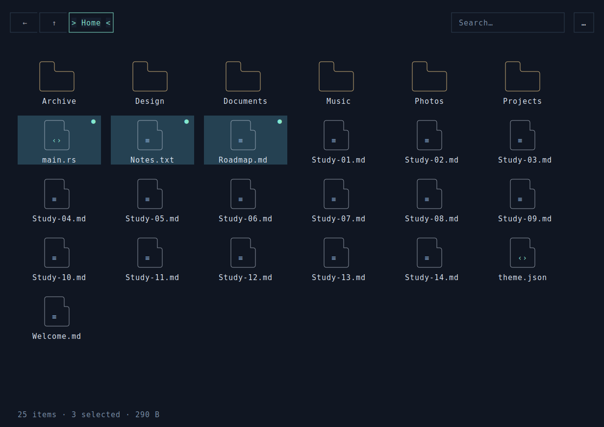
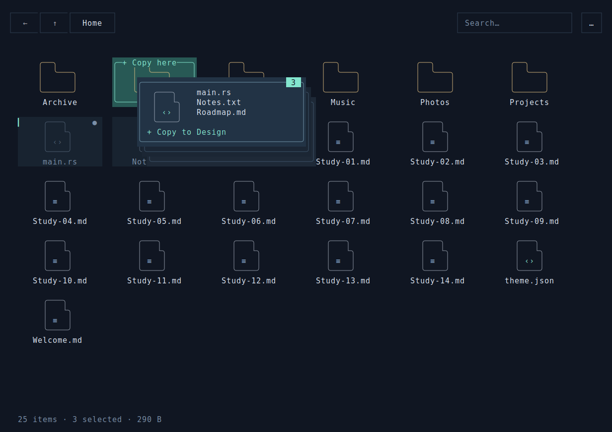

# Orbit Files

[English](README.md) · 中文

使用 rsille 构建的文件管理器，支持框选、多文件拖放、复制／剪切／粘贴、预览、右键菜单和撤销。
实际读取和修改本地文件，通过后台任务执行复制和批量移动。




## 运行

在仓库根目录执行：

```bash
cargo run --release --manifest-path examples/orbit-files/Cargo.toml
cargo run --release --manifest-path examples/orbit-files/Cargo.toml -- --path ~/Downloads
```

默认创建一次性演示目录，将导航限制在其中，正常退出时清理。
**`--path DIR` 会操作真实文件。** 完整文件操作需要 Linux。建议使用支持 True Color、
Unicode 和鼠标的终端，窗口至少 100 × 30。`--inline` 使用普通终端屏幕。

## 选择、导航与整理

点击选择，Ctrl+点击增减选择，Shift+点击选择范围。在空白处拖动进行框选，Ctrl 或 Shift
可追加选择。把选中的文件拖到文件夹上可整组移动，松手时按住 Ctrl 则复制。
悬浮预览显示选中文件与目标，Esc、失焦或调整窗口大小会取消拖动。

双击文件夹进入，双击文件预览。预览显示符号链接目标或开头最多 4 KiB 的文本，二进制文件
显示提示。右键条目或空白处打开操作菜单；顶部“…”菜单还提供排序、网格／列表和隐藏文件选项。
搜索不区分大小写，仅筛选当前目录。

文件快捷键在文件区获得焦点时生效；编辑器保留自身的文本编辑快捷键。剪贴板是应用内的路径列表。

| 按键 | 操作 |
| --- | --- |
| 方向键 / Home / End / PageUp / PageDown | 导航并滚动 |
| Shift+方向键 / Ctrl+方向键 / 空格 | 扩展范围 / 移动但保留选择 / 切换当前项选择 |
| Ctrl+A | 选择所有符合筛选条件的条目，包括屏幕外条目 |
| Ctrl+C / Ctrl+X / Ctrl+V | 复制 / 剪切 / 粘贴 |
| Ctrl+Z / Ctrl+N | 撤销 / 新建文件夹 |
| Delete / F2 / F5 | 确认移入暂存回收目录 / 重命名 / 刷新 |
| Enter / Backspace / Alt+左 / Alt+右 | 打开 / 上级 / 后退 / 前进 |
| Ctrl+H / Ctrl+F / Ctrl+L | 隐藏文件 / 搜索 / 地址 |
| F1 / Tab / Shift+Tab | 帮助 / 下一焦点 / 上一焦点 |
| Esc / Ctrl+Q | 关闭弹窗、取消拖动或清空选择 / 确认退出 |

## 文件操作约定

- 目录递归复制，重名时生成 `name (copy 1).ext` 等副本名。
- 移动、重命名和撤销使用 Linux `RENAME_NOREPLACE`，目标已存在时失败。
  跨文件系统移动会失败，可改用复制。
- 删除将条目移入原父目录下的 `.orbit-trash-<唯一标识>/`。这是应用管理的暂存目录，
  不接入系统回收站。真实目录模式退出后仍保留，应用不提供永久删除。
- 撤销覆盖本次会话中成功的移动、重命名和暂存删除；复制与新建文件夹不支持撤销。
  重启后可到隐藏暂存目录中手动恢复。
- Unix 符号链接按链接本身复制，跳过特殊文件。批量操作部分失败时保留成功结果并报告错误。
  外部修改后用 F5 刷新。

## 验证与导出

```bash
cargo run --manifest-path examples/orbit-files/Cargo.toml -- --headless
cargo test --manifest-path examples/orbit-files/Cargo.toml
cargo run --manifest-path examples/orbit-files/Cargo.toml -- --snapshot /tmp/orbit-files.svg
cargo run --manifest-path examples/orbit-files/Cargo.toml -- --snapshot-drag /tmp/orbit-drag.svg
```

验证使用临时文件和真实运行时。快照导出 120 × 42 画面；`--snapshot-drag` 仅支持演示模式，
捕获拖动状态但不执行松手操作。

[main.rs](src/main.rs) 管理状态和任务，[board.rs](src/board.rs) 实现文件区，
[files.rs](src/files.rs) 执行磁盘操作，[ui.rs](src/ui.rs) 构建导航和 Portal 弹窗，
[drag.rs](src/drag.rs) 与 [icons.rs](src/icons.rs) 绘制拖动反馈和图标，
[verify.rs](src/verify.rs) 验证交互。

[全部示例](../README_cn.md)
