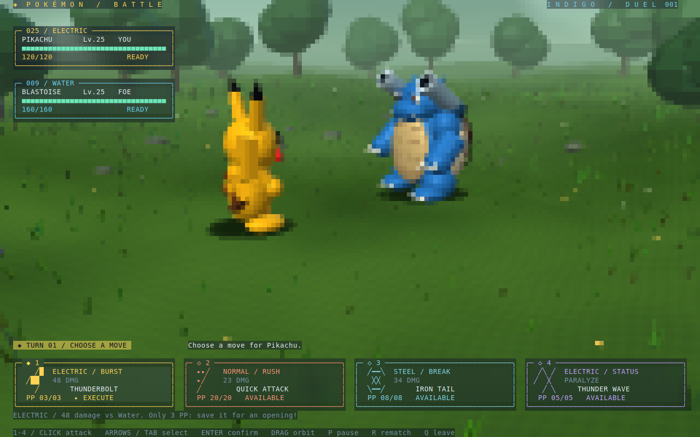

# Pokémon Battle / 宝可梦对战

English · [中文](README_cn.md)

Play Pikachu against an automated Blastoise in a 3D meadow. Choose moves, watch attacks
resolve and manage HP, PP, paralysis and guard. The scene and models are generated on
the CPU, with native TUI buttons and health bars over frosted backdrops.



## Run

From the repository root:

```bash
cargo run --release --manifest-path examples/pokemon-battle/Cargo.toml
```

Use a True Color terminal, preferably 160 × 50 or larger; 80 × 24 also works. The default
encoder is Half-block with 2 × 2 supersampling. Press b to switch to Braille.

## Battle

Pikachu starts with 120 HP and Blastoise with 160 HP. Pikachu acts first; damage resolves
once at impact. Moves cannot be queued during attack animations or pause.

| Key | Move | PP | Effect |
| --- | --- | --- | --- |
| 1 | Thunderbolt | 3 | 48 damage |
| 2 | Quick Attack | 20 | 23 damage |
| 3 | Iron Tail | 8 | 34 damage; bypasses guard |
| 4 | Thunder Wave | 5 | Paralysis; prevents retaliation on even turns |

Blastoise cycles Hydro Pump (28 damage), Tackle (22), Withdraw and Hydro Pump.
Withdraw halves the next direct hit unless bypassed by Iron Tail. Reapplying paralysis
or choosing an exhausted move does not spend a turn. These are simplified demo rules.

| Input | Action |
| --- | --- |
| 1–4 / click a move | Use the selected move directly |
| Arrows / Tab / Shift+Tab | Focus an available move |
| Enter / Space | Activate the focused move |
| Left drag in the scene / w, a, s, d | Orbit the camera |
| Wheel / + / - | Zoom |
| c | Reset camera |
| p / r / b | Pause / rematch / change encoder |
| q / Esc / Ctrl+C | Exit |

## Verify and export

```bash
cargo test --manifest-path examples/pokemon-battle/Cargo.toml
cargo run --release --manifest-path examples/pokemon-battle/Cargo.toml -- --headless
cargo run --release --manifest-path examples/pokemon-battle/Cargo.toml -- --snapshot /tmp/pokemon.svg
cargo run --release --manifest-path examples/pokemon-battle/Cargo.toml -- --snapshot /tmp/pokemon-attack.svg 0.9 braille
```

`--snapshot FILE.svg [SECONDS] [block|braille]` exports the actual 160 × 50 runtime buffer.
Defaults are 0 seconds and `block`, showing move selection. A positive time chooses one
Thunderbolt and advances 0–3600 seconds; it does not start another turn automatically.
Headless verification completes a battle through keyboard input and checks victory.

[battle.rs](src/battle.rs) contains combat rules; [scene.rs](src/scene.rs),
[environment.rs](src/environment.rs), [geometry.rs](src/geometry.rs) and
[raster.rs](src/raster.rs) build and draw the world. [battle_ui.rs](src/battle_ui.rs)
composes the HUD and move cards. Frosted backgrounds sample already rendered terminal
cells through `Backdrop`; they do not require terminal-window transparency.

[All examples](../README.md)
