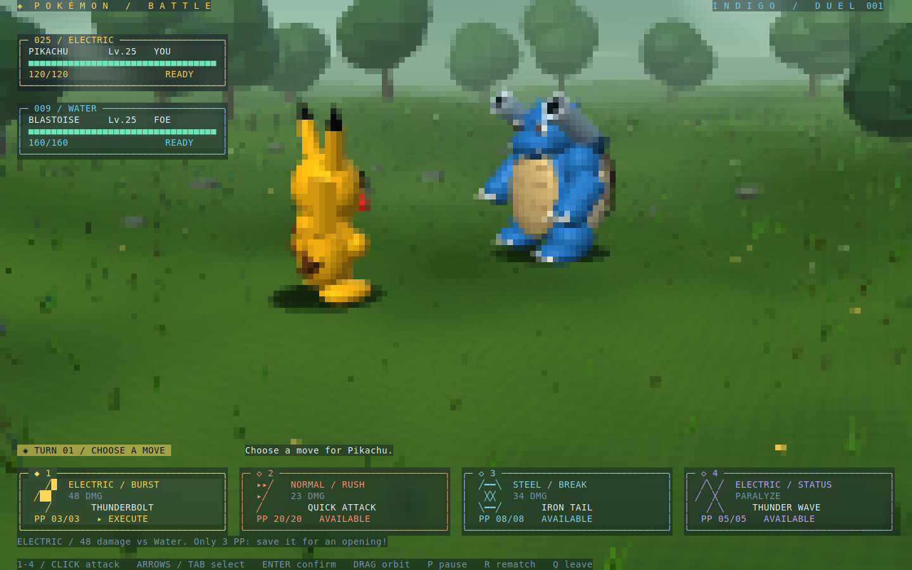

# Pokémon Battle / 宝可梦对战

你控制皮卡丘，在开阔草地中与水箭龟进行回合制对战。选择技能、观看出招和受击动画，
水箭龟自动还击；双方 HP、技能 PP、麻痹和防御状态实时显示。击倒对手获胜，按 `r` 再来一局。

```sh
cargo run --release --manifest-path examples/pokemon-battle/Cargo.toml
```



推荐支持 True Color 的终端，窗口 **160×50** 或更大；**80×24** 也可运行。
默认使用 Half-block 编码和 2×2 超采样，按 `b` 可切换 Braille。

开局采用背侧斜向对战视角：皮卡丘在近处面向远处的水箭龟，角色真正朝向彼此。
左上角堆叠电黄／水蓝圆角血量卡，带分段 HP 条及麻痹、防御标识；底部是四张独立的属性技能卡，
分别使用电黄、珊瑚、冰蓝、紫色，配有技能图案、伤害、PP、选中及鼠标悬停反馈。
宽窗口下四张卡横向排列；较窄窗口下切成两行，键盘方向导航随布局变化。
水箭龟会压低双肩炮再发射两束水流。

血量卡与底部技能卡使用半透明毛玻璃背景，场景绘制覆盖整个窗口，草地会延伸到技能卡后面。
面板下的树影、草色与战斗画面会随相机和动画同步变化；文字、血条和原生圆角边框保持清晰。
技能卡之间直接露出草地，底部不再切出一整块不透明区域。

## 怎么玩

开局等待你选择技能。直接按 `1`–`4` 出招，或者用方向键／Tab 选中技能后按 Enter／空格确认；
也可以直接点击底部技能按钮。Tab／Shift+Tab 遍历可用技能，耗尽或不可用的技能会跳过。
动画期间无法重复出招，伤害在命中时结算一次。
皮卡丘先手，水箭龟行动后进入下一回合；击倒对手后不会再遭到反击。

| 技能 | PP | 作用 |
| --- | --- | --- |
| `1` 十万伏特 / Thunderbolt | 3 | 对水系水箭龟造成 48 点伤害，适合留到对手没有防御时使用 |
| `2` 电光一闪 / Quick Attack | 20 | 冲刺撞击，造成 23 点伤害 |
| `3` 铁尾 / Iron Tail | 8 | 旋身攻击，造成 34 点伤害，并穿透缩壳的防御 |
| `4` 电磁波 / Thunder Wave | 5 | 使对手麻痹；此后偶数回合的反击无法行动，无直接伤害 |

皮卡丘初始 **120 HP**，水箭龟初始 **160 HP**。水箭龟依次使用水炮（28 伤害）、
撞击（22 伤害）、缩壳、水炮，然后重复。缩壳使下一次直接伤害减半，铁尾可以穿透。
已经麻痹时不能重复使用电磁波；PP 耗尽时必须选择其他技能，均不会白白消耗回合。
这是为示例设计的简化战斗规则，数值和技能效果并非原作战斗系统的完整实现。

| 按键／鼠标 | 操作 |
| --- | --- |
| `1`–`4` / 点击技能 | 直接使用指定技能 |
| 方向键 / Tab | 选择技能 |
| Enter / 空格 | 使用当前选中的技能 |
| 场景内左键拖动 / WASD | 绕场景旋转相机 |
| 滚轮 / `+` / `-` | 缩放 |
| `c` | 恢复默认视角 |
| `p` | 暂停／继续；暂停时不能出招，仍可转动相机 |
| `r` | 重新开局，恢复 HP、PP 并清除状态 |
| `b` | 切换 Half-block / Braille |
| `q` / Esc / Ctrl+C | 退出并恢复终端 |

## 实现与验证

模型均由代码生成的实体三角网格组成，包括皮卡丘的长耳、红脸颊、闪电尾巴，
以及水箭龟的厚重龟壳、腹甲、爪子和带真实炮口的双肩炮。CPU 光栅器计算透视、深度遮挡和光照；
转动相机可以看到侧面及背面。技能包含电弧、水流、冲刺、旋转和防御光环。
场景是一片连续延伸的草地，包含起伏地形、随风摆动的草丛、树木、野花和小石块；
远处使用薄雾形成纵深，脚下保留简化接触阴影。无需下载图片、模型或其他素材。

界面运行在 `rsille::tui::App` 上，复用现成组件：

- `canvas()` 承载 3D 场景，`drag_region()` 负责鼠标捕获、拖动及失焦／缩放窗口时的取消。
- `grid()`、`col()` 和 `overlay()` 负责响应式排列及左上角血量浮层。
- 原生 `button()` 负责技能卡内部的点击、Enter／空格激活、禁用、焦点与悬停。
- 血量使用 `panel()`、`label()` 和分段 `progress_bar()`；血量及技能卡整体通过 `overlay()` 悬浮。

血量面板与技能卡的边框均使用原生 `Panel` 的 `BorderStyle::Rounded`，不手工绘制边角。
`battle_ui.rs` 中的 `FixedHeight` 仅约束面板高度，`MoveCard` 仅补充技能图案及 PP 装饰，
不维护点击矩形、按下状态或悬停状态；技能名由原生 Button 绘制。方向键导航通过框架的焦点请求
切换按钮，Tab 及禁用目标过滤由框架处理。键盘数字键只负责派发出招消息。

`main.rs` 定义应用状态、消息及更新函数；`battle.rs` 管理回合、命中及胜负。
`scene.rs` 生成模型动作，`environment.rs` 生成草地，`geometry.rs` 提供图元，`raster.rs` 处理光栅化。
3D 输出由 TUI Canvas 编码为 Half-block 或 Braille，布局、事件路由和终端生命周期统一由 TUI 运行时管理。
`glass.rs` 通过公开的 `Visual::custom_effect`／`CellEffect` 实现毛玻璃：对当前 3D 像素作一次可分离背景模糊，
按面板的实际屏幕坐标采样，与控件原有底色混合，只合成背景 RGB，保留文字及原生边框。
两种编码共享相同的 2×4 子像素背景采样，不依赖终端窗口透明度，也不会模糊技能文字。
战斗逻辑与绘制分离，绘制不会推进回合或造成伤害。

```sh
cargo test --manifest-path examples/pokemon-battle/Cargo.toml
cargo clippy --manifest-path examples/pokemon-battle/Cargo.toml --all-targets -- -D warnings
cargo run --release --manifest-path examples/pokemon-battle/Cargo.toml -- --headless
cargo run --release --manifest-path examples/pokemon-battle/Cargo.toml -- --snapshot /tmp/pokemon-menu.svg
cargo run --release --manifest-path examples/pokemon-battle/Cargo.toml -- --snapshot /tmp/pokemon-electric.svg 0.9
cargo run --release --manifest-path examples/pokemon-battle/Cargo.toml -- --snapshot /tmp/pokemon-water.svg 2.7
cargo run --release --manifest-path examples/pokemon-battle/Cargo.toml -- --snapshot /tmp/pokemon-braille.svg 0.9 braille
```

`--snapshot FILE.svg [SECONDS] [block|braille]` 导出真实 TUI Runtime 的 160×50 字符 Buffer。
默认 0 秒，显示技能选择界面；指定正数时自动选择一次十万伏特，再推进相应秒数，
演示玩家出招、对手反击及重新等待输入。秒数范围 0–3600，不会自动开始第二回合。
半块字符按采样矩形导出，盲文按圆点导出。

`--headless` 使用 TUI Runtime 与手动时钟，通过真实键盘消息自动完成一局并验证胜利。
测试保留战斗规则和三维遮挡检查，并使用同一 TUI Runtime 验证原生按钮点击、重复输入锁定、
Tab 跳过禁用技能、方向键焦点、鼠标悬停、布局实际命中范围、窗口调整、拖动捕获与失焦取消，
以及 HP 数值与原生血条随命中变化、两种编码下的小窗口绘制及确定性快照。
毛玻璃检查覆盖模糊核、全屏背景范围、面板下的空间色彩变化、相机转动后的背景更新，以及文字和圆角保留。
