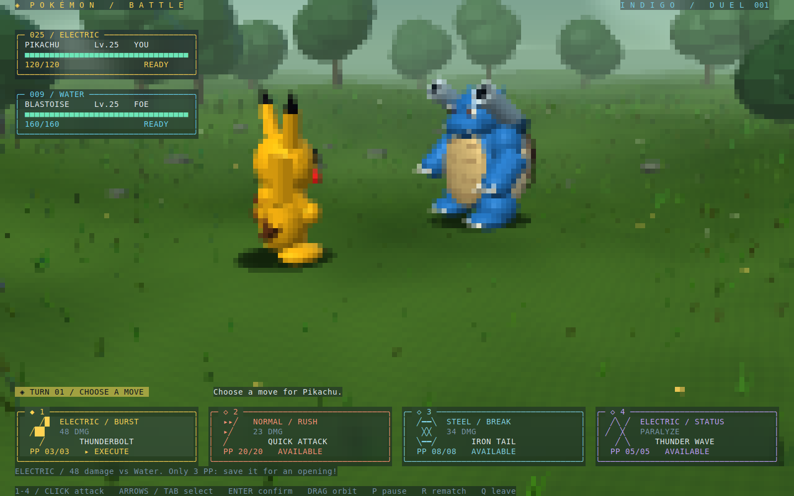

# Pokémon Battle / 宝可梦对战

[English](README.md) · 中文

在三维草地中操控皮卡丘对战自动行动的水箭龟。选择技能、观看出招，管理 HP、PP、麻痹和防御。
场景和模型在 CPU 上生成，原生 TUI 按钮、血条通过毛玻璃背景悬浮在画面之上。



## 运行

在仓库根目录执行：

```bash
cargo run --release --manifest-path examples/pokemon-battle/Cargo.toml
```

建议使用 True Color 终端，窗口至少 160 × 50，80 × 24 也可运行。
默认使用 Half-block 编码和 2 × 2 超采样，按 b 切换 Braille。

## 对战

皮卡丘初始 120 HP，水箭龟初始 160 HP。皮卡丘先手，伤害在命中时结算一次。
出招动画和暂停期间不能追加技能。

| 按键 | 技能 | PP | 效果 |
| --- | --- | --- | --- |
| 1 | 十万伏特 | 3 | 48 点伤害 |
| 2 | 电光一闪 | 20 | 23 点伤害 |
| 3 | 铁尾 | 8 | 34 点伤害，穿透防御 |
| 4 | 电磁波 | 5 | 麻痹，使对手在偶数回合无法反击 |

水箭龟依次使用水炮（28 伤害）、撞击（22）、缩壳、水炮，然后重复。
缩壳使下一次直接伤害减半，铁尾可穿透。重复麻痹或选择已耗尽的技能不消耗回合。
这是为示例设计的简化规则。

| 输入 | 操作 |
| --- | --- |
| 1–4 / 点击技能 | 直接使用对应技能 |
| 方向键 / Tab / Shift+Tab | 聚焦可用技能 |
| Enter / 空格 | 使用当前聚焦的技能 |
| 场景内左键拖动 / w、a、s、d | 转动相机 |
| 滚轮 / + / - | 缩放 |
| c | 恢复相机 |
| p / r / b | 暂停 / 重新对战 / 切换编码 |
| q / Esc / Ctrl+C | 退出 |

## 验证与导出

```bash
cargo test --manifest-path examples/pokemon-battle/Cargo.toml
cargo run --release --manifest-path examples/pokemon-battle/Cargo.toml -- --headless
cargo run --release --manifest-path examples/pokemon-battle/Cargo.toml -- --snapshot /tmp/pokemon.svg
cargo run --release --manifest-path examples/pokemon-battle/Cargo.toml -- --snapshot /tmp/pokemon-attack.svg 0.9 braille
```

`--snapshot FILE.svg [SECONDS] [block|braille]` 导出真实运行时的 160 × 50 Buffer。
默认 0 秒、`block`，展示技能选择界面；正数时间会先选择一次十万伏特，再推进指定的
0–3600 秒，不会自动开始下一回合。无终端验证通过键盘输入完成一局并检查胜利。

[battle.rs](src/battle.rs) 管理战斗规则；[scene.rs](src/scene.rs)、
[environment.rs](src/environment.rs)、[geometry.rs](src/geometry.rs) 和
[raster.rs](src/raster.rs) 构建并绘制世界，[battle_ui.rs](src/battle_ui.rs) 组合 HUD 和技能卡。
毛玻璃通过 `Backdrop` 采样已渲染的终端字符，不依赖终端窗口透明度。

[全部示例](../README_cn.md)
